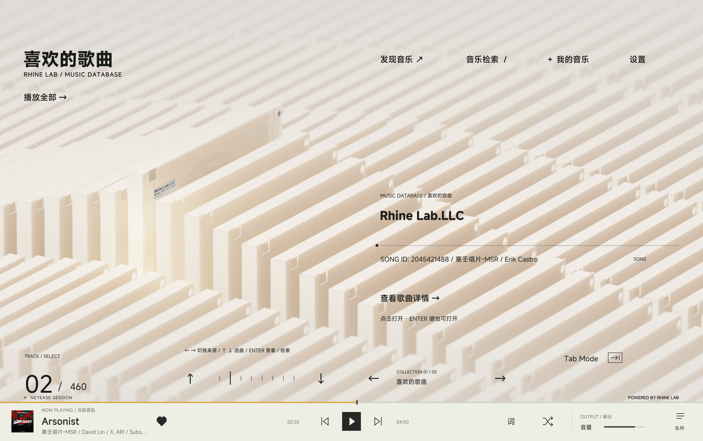
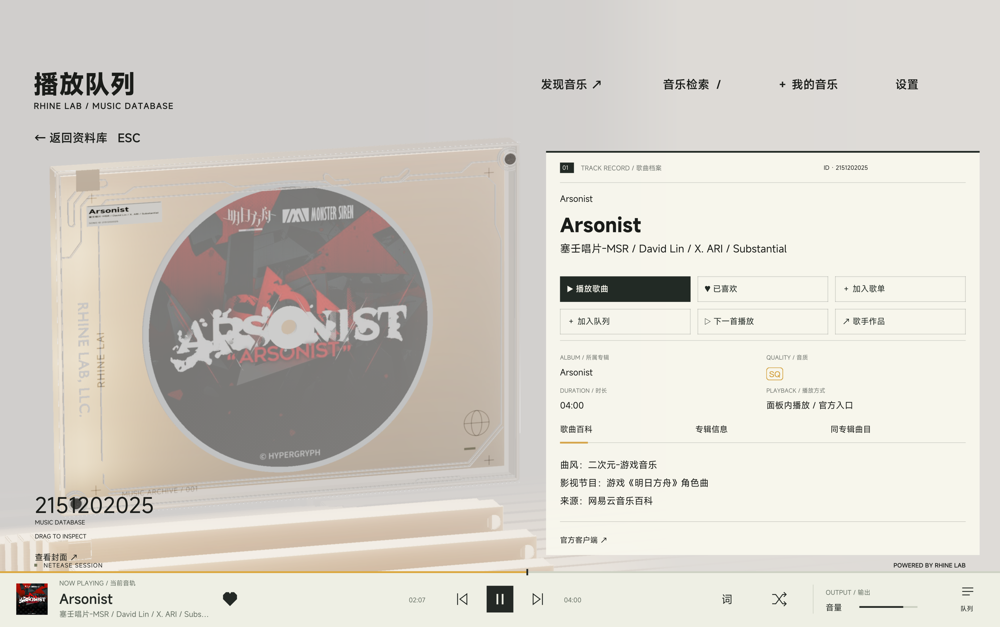
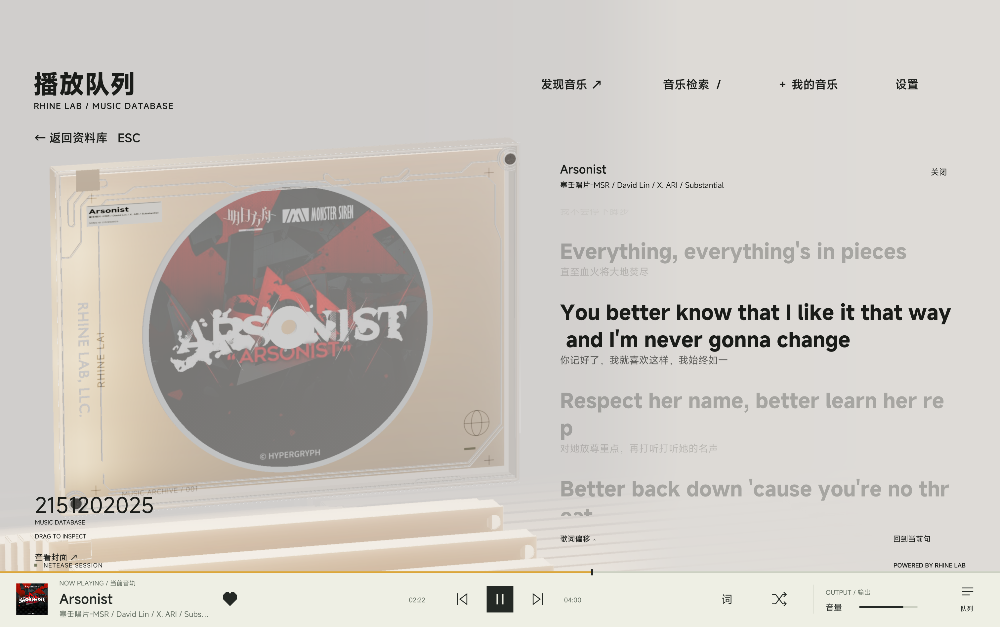
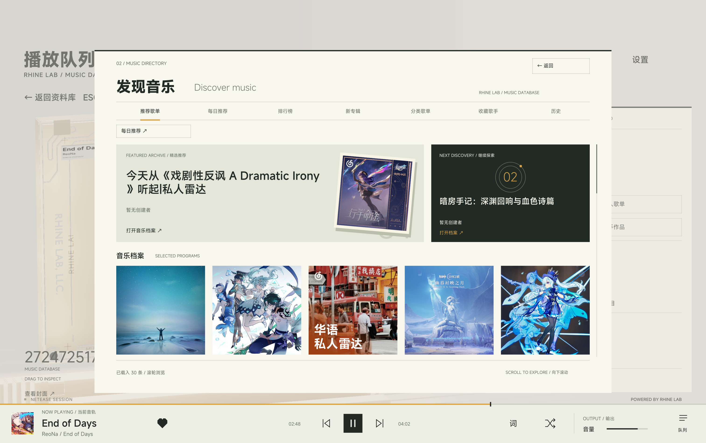
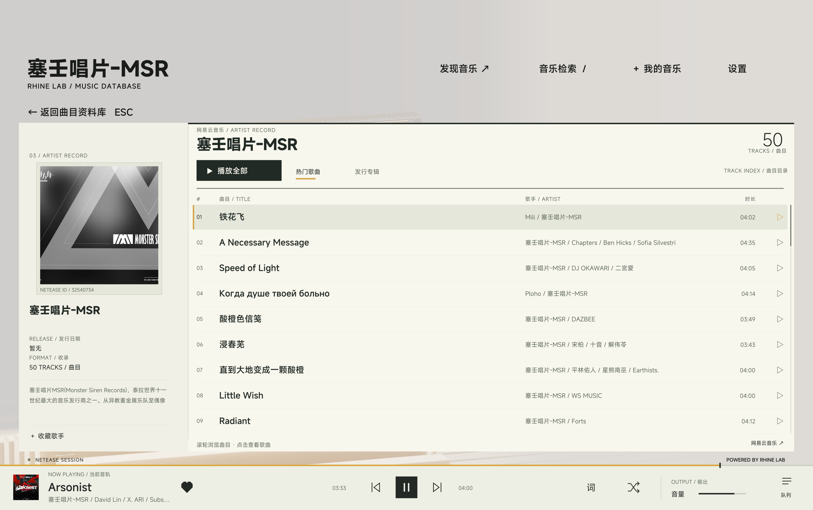
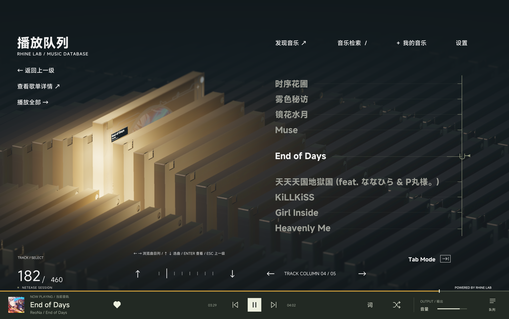
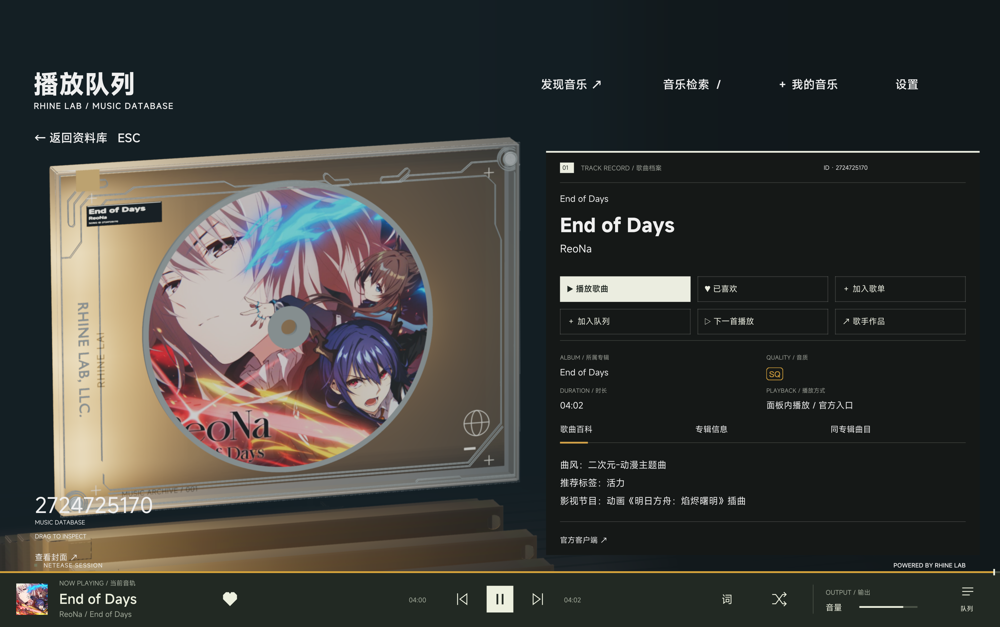
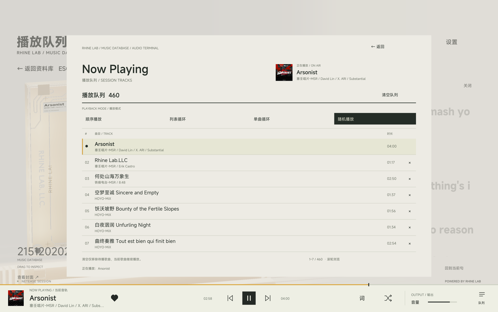
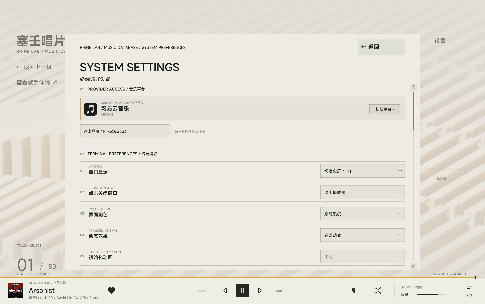

# RHINE MUSIC DATABASE

**基于莱茵生命终端的音乐面板**

本项目是对《明日方舟》特别映像「莱茵生命：访问」终端界面的非官方复刻。

界面使用 **Qt 6 / QML / C++** 构建，支持 macOS、Windows、 Linux 和 iOS / iPadOS。

Rhine Music Database 提供插件化多来源检索、账号登录、播放、同步歌词、本地音乐与关联 MV。

默认支持**塞壬唱片**（官网音源）和**本地音乐**，第三方音乐来源可在插件市场安装、启用或卸载。

**音质和播放取决于账号权限；本项目不提供音乐下载。**

[界面预览](#界面预览) · [快速开始](#快速开始) · [功能列表](#功能列表)· [图形后端与渲染能力](#图形后端与渲染能力) · [从源码构建](#从源码构建)



## 界面预览

<table>
  <tr>
    <td width="50%"></td>
    <td width="50%"></td>
  </tr>
  <tr>
    <td align="center"><strong>歌曲详情</strong></td>
    <td align="center"><strong>同步歌词</strong></td>
  </tr>
  <tr>
    <td width="50%"></td>
    <td width="50%"></td>
  </tr>
  <tr>
    <td align="center"><strong>探索</strong></td>
    <td align="center"><strong>歌手页与曲目列表</strong></td>
  </tr>
  <tr>
    <td width="50%"></td>
    <td width="50%"></td>
  </tr>
  <tr>
    <td align="center"><strong>Tab Mode（暗色）</strong></td>
    <td align="center"><strong>歌曲详情（暗色）</strong></td>
  </tr>
  <tr>
    <td width="50%"></td>
    <td width="50%"></td>
  </tr>
  <tr>
    <td align="center"><strong>播放队列</strong></td>
    <td align="center"><strong>面板设置</strong></td>
  </tr>
</table>

## 快速开始

### 获取应用

请从 [GitHub Releases](https://github.com/MikeQu223/Rhine-Music-Database/releases) 下载对应平台的安装包。源码构建产物位于：

| 平台         | 程序                                                         |
| ------------ | ------------------------------------------------------------ |
| macOS        | `output/RHINE MUSIC DATABASE.app`                            |
| Windows      | `output/RhineMusicDatabase-<构建标识>-Windows-x64-Setup.exe` |
| Linux        | `output/RhineMusicDatabase-<构建标识>-Linux-x86_64.AppImage` |
| iOS / iPadOS | `output/RhineMusicDatabase-<构建标识>-ios-unsigned.ipa`      |

> [!WARNING]
> 仅在确认安装包来自本项目 Releases 后执行以下命令。
>
> macOS 若提示应用已损坏，可移除隔离属性：
>
> ```sh
> xattr -r -d com.apple.quarantine '/Applications/RHINE MUSIC DATABASE.app'
> ```
>
> 随后前往「系统设置 → 隐私与安全性」允许打开。

Windows 运行 `RhineMusicDatabase-<构建标识>-Windows-x64-Setup.exe` 安装程序。

Linux 赋予执行权限后直接运行 AppImage。Qt 运行时、QML 模块、FFmpeg 与 Node 桥接都已随包提供：

```sh
chmod +x 'RhineMusicDatabase-<构建标识>-Linux-x86_64.AppImage'
./'RhineMusicDatabase-<构建标识>-Linux-x86_64.AppImage'
```

没有 FUSE 的环境（容器、部分滚动发行版）可追加 `--appimage-extract-and-run` 参数。

iOS / iPadOS 需要使用自签工具安装，推荐使用 [iloader](https://github.com/nab138/iloader)。

Linux 和 Windows 默认使用 FFmpeg 音频后端。Windows 设置 `QT_MEDIA_BACKEND=windows` 可临时使用原生后端。macOS 和 iOS / iPadOS 使用 AVPlayer 音频后端。


## 功能列表

勾选表示已实现；未勾选表示当前未实现，不代表承诺开发。

### 第三方音乐平台

- [x] 歌曲、专辑、歌单、歌手搜索与分页
- [x] 歌手歌曲分页与发行专辑
- [x] 扫码、手机短信验证码登录
- [x] 喜欢歌曲与收藏歌单、专辑、歌手
- [x] 创建、重命名、删除自己的歌单
- [x] 歌曲加入或移出歌单
- [x] 每日推荐、推荐歌单、排行榜、新专辑、分类歌单
- [x] 面板内播放与插件声明的官方客户端入口
- [x] 同步歌词与逐句滚动
- [x] 歌曲评论浏览：由支持评论 operation 的插件读取；塞壬唱片可匹配可用评论来源
- [x] 关联 MV 自动静音播放、独立窗口、视频版本选择、全屏与透明度调节
- [x] Windows 桌面壁纸模式、显示器选择、桌面进度控制与音乐频谱波浪
- [ ] 云盘、电台
- [ ] 音乐下载

### 本地音乐

- [x] 导入文件或递归导入文件夹并建立索引，支持 MP3、FLAC、M4A、MP4、AAC、OGG、Opus、APE、WAV、AIFF、WV、WMA、MPC
- [x] 读取标题、歌手、专辑、年份、时长、采样率与码率；无标签时从“歌手 - 歌名”文件名推断检索词
- [x] 同目录 `cover`、`folder` 或 `front` 图片优先，其次读取内嵌封面，封面缓存到应用数据目录
- [x] 同名 `.lrc` 歌词优先，其次内嵌歌词；本地歌词来源可选自动、本地或指定平台
- [x] 缺少歌词或封面时复用跨平台录音匹配补充，不改写音频标签或音乐文件
- [x] 按歌曲、歌手、专辑与文件夹分组浏览，支持本地检索
- [x] 面板内播放、播放队列与同步歌词
- [x] 按文件名、编码格式、采样率与码率近似匹配插件提供的音质档位
- [x] `.rhineignore` 或 `.foliaignore` 排除规则，支持 `*`、`?`、`**`、目录末尾 `/`、根路径前导 `/` 与 `!` 否定
- [x] 重新扫描、取消扫描；移除导入位置只删除索引，不删除磁盘文件
- [x] 离线时已导入的曲目、封面与本地歌词仍可播放

### 面板

- [x] 三维光盘盒、唱片与资料库动画
- [x] 原生全屏与窗口模式切换
- [x] 按歌手或专辑分组浏览已载入结果
- [x] 多来源插件直接选择与账号、请求、缓存隔离
- [x] 播放、暂停、切歌、进度与音量控制
- [x] 播放栏歌词入口、当前歌曲歌词页面、点击歌词跳转、单曲时间校准与离线歌词缓存
- [x] 播放队列、删除待播曲目、循环与随机播放
- [x] 搜索历史、播放历史与本机偏好保存
- [x] 亮色、暗色、跟随系统与减少动效
- [x] 音质选择、试听提示与可选替代音源
- [x] macOS 系统媒体按钮
- [x] macOS Apple Silicon、Linux x86_64 与 Windows x64 构建和打包
- [x] 歌曲关联 MV 自动播放（桌面端）

## 图形后端与渲染能力

| Platform     | Vulkan | Direct3D 12 | OpenGL | Metal |
| ------------ | ------ | ----------- | ------ | ----- |
| Windows      | ✅ （默认） | ✅          | ✅     | -     |
| macOS        | -      | -           | -      | ✅    |
| iOS / iPadOS | -      | -           | -      | ✅    |
| Linux        | ✅ （默认） | -           | ✅     | -     |

| API         | FXAA   | SSAA   | MSAA   | TAA     | Upscaling        | Frame Generation |
| ----------- | ------ | ------ | ------ | ------- | ---------------- | ---------------- |
| Vulkan      | ✅     | 2x MAX | 8x MAX | ✅      | EASU + RCAS      | ✅               |
| Direct3D 12 | ✅     | 2x MAX | 8x MAX | ✅      | EASU + RCAS / FSR3 | ✅               |
| OpenGL      | ✅     | 2x MAX | 8x MAX | ✅      | EASU + RCAS      | -                |
| Metal       | -      | -      | -      | MetalFX | MetalFX Temporal | MetalFX          |

## 从源码构建

### 构建

**桌面端构建要求：** Qt 6.12+（含 Shader Tools、Multimedia）、CMake 3.24+、Ninja、Python 3、Node.js / npm 及对应平台的 C++ 编译器。官方 CI 统一使用 Qt 6.12.0 和 Node.js 26.11.1。Linux 额外需要 Qt 私有开发头文件。

克隆时请同步子模块（包含 FidelityFX SDK、DXC、glslang 等构建依赖）：

```
git clone --recurse-submodules <仓库地址>
```

**桌面端构建命令：**

```
npm ci
npm run build
npm test
npm run share
```

`QT_ROOT` 可指定 Qt kit 路径；`RHINE_NODE_BINARY` 和 `RHINE_NODE_LICENSE` 用于指定随应用打包的独立 Node.js 运行时。默认构建为 **core-only**，完整开发包可使用 `npm run build -- --plugins=full`。

**平台产物：**

- **Windows x64：** Inno Setup 安装程序（`.exe`），支持 D3D12 / FidelityFX FSR3。
- **macOS：** 使用 Xcode 工具链构建与打包。
- **Linux x86_64：** AppImage，默认采用 DwarFS 压缩；另支持 NixOS 原生构建（`nix-build`）。
- **iOS / iPadOS：** `npm run build:ios`，生成待签名的 IPA。
- **Android arm64：** `npm run build:android`，生成可侧载的 APK，最低支持 Android 9。

移动端需要对应的 Qt kit、SDK 及平台工具链。部分功能（如 FSR3）依赖完整子模块，缺失时可能被跳过或导致构建失败。

### 调试

默认使用 **Release** 构建，Linux 自动启用 LTO 优化（不可用时降级并告警）。CI 使用 `RHINE_REQUIRE_LTO=1` 强制要求 LTO。

可通过以下环境变量控制构建：

- `RHINE_BUILD_TYPE=Debug`：启用调试构建。
- `RHINE_VERSION=vX.Y.Z`：指定正式版本号；未设置时自动生成包含 Git SHA 和提交信息的开发版。
- `QT_ROOT` / `PYTHON`：指定 Qt 路径与 Python 命令。

**常用调试命令：**

```
npm run build     # 构建
npm test          # 运行离线测试
npm run preview   # QML 实时预览（需对应 Qt 工具）
```

`npm test` 覆盖播放状态、账号隔离、输入法交互、窗口行为、依赖锁定及打包资源等核心功能，但**无法替代真实账号、在线音源及跨平台实机测试**。

项目使用 Qt RHI 私有接口，升级 Qt 后需重新编译并验证兼容性。

## 数据与隐私

搜索、歌曲资料、扫码与个人音乐库请求发送至已安装音乐来源插件声明的 API 与图片域名。原始认证记录仅由 C++ 和 Node 桥处理：

- macOS：保存在钥匙串。
- Windows：通过 DPAPI 加密。
- Linux：保存在 `~/.local/share/RhineMusicDatabase/rhine.music.database/account.credential`，权限为 `0600`。

本项目没有自建的数据收集服务器、分析 SDK 或自动上传诊断功能。

登录为可选功能。应用不读取浏览器或官方客户端的登录信息。

## Star History

<a href="https://www.star-history.com/?repos=mikequ223%2Frhine-music-database&type=date&legend=top-left">

 <picture>
   <source media="(prefers-color-scheme: dark)" srcset="https://api.star-history.com/chart?repos=mikequ223/rhine-music-database&type=date&theme=dark&legend=top-left" />
   <source media="(prefers-color-scheme: light)" srcset="https://api.star-history.com/chart?repos=mikequ223/rhine-music-database&type=date&legend=top-left" />
   
 </picture>
</a>

## 参考项目

- **[LBEILC / RhineLabUI](https://github.com/LBEILC/RhineLabUI)**：特别感谢原界面、模型与场景作者，版权声明随项目保留。
- **[LyricsX](https://github.com/MxIris-LyricsX-Project/LyricsX)**：歌词获取、解析与显示分层参考。
- **[LyricsKit](https://github.com/MxIris-LyricsX-Project/LyricsKit)**：LRC、YRC、KRC 格式解析移植，`MusicBridge/lyrics-format.cjs` 单独采用 MPL-2.0，固定版本与许可随包保留。
- **[Lyrimuse](https://github.com/Yudaotor/lyrimuse)**：统一时间轴、歌词同步与录音版本匹配思路参考。

## 声明与许可

本项目在开发过程中广泛使用了 AI 辅助，仍可能存在细微或不易察觉的问题。如遇到问题，欢迎通过 Issue 反馈。

本项目保留 [MIT License](LICENSE) 与原作者版权声明。第三方字体、Qt 和依赖分别遵循各自许可证；相关许可随部署包保留。

《明日方舟》、莱茵生命及其名称、标志与原作视觉设计的相关权利归各自权利人所有。本项目为非官方衍生作品，项目的 MIT 许可不代替第三方内容的授权。
