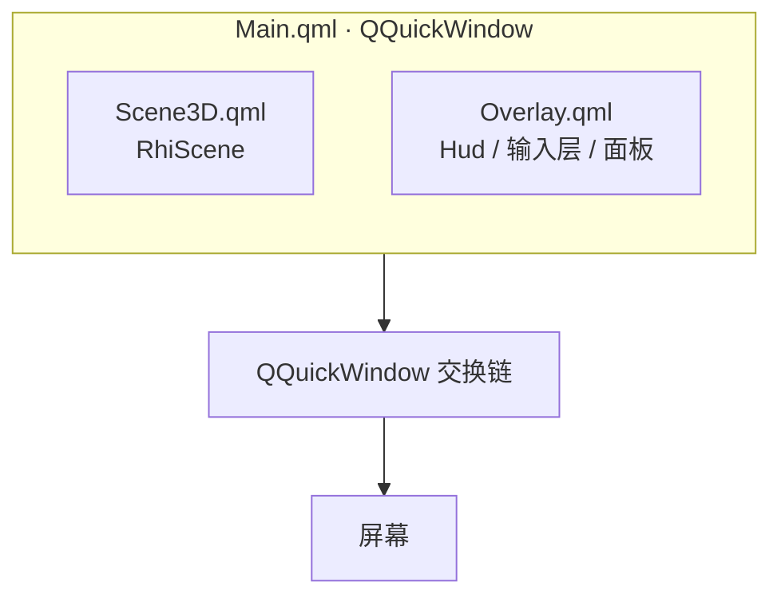
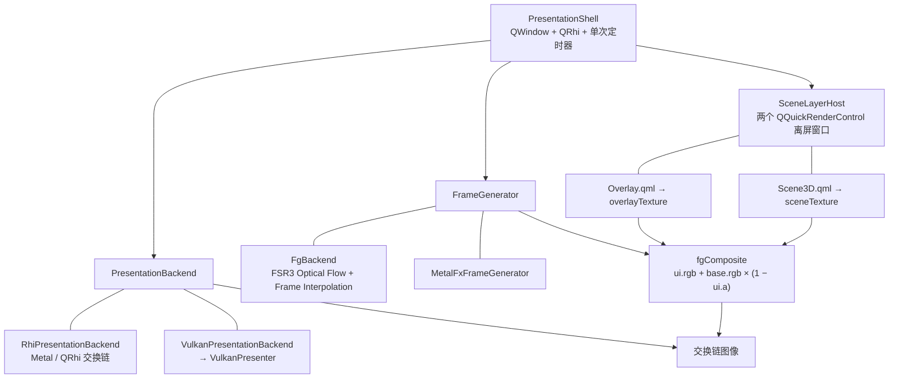
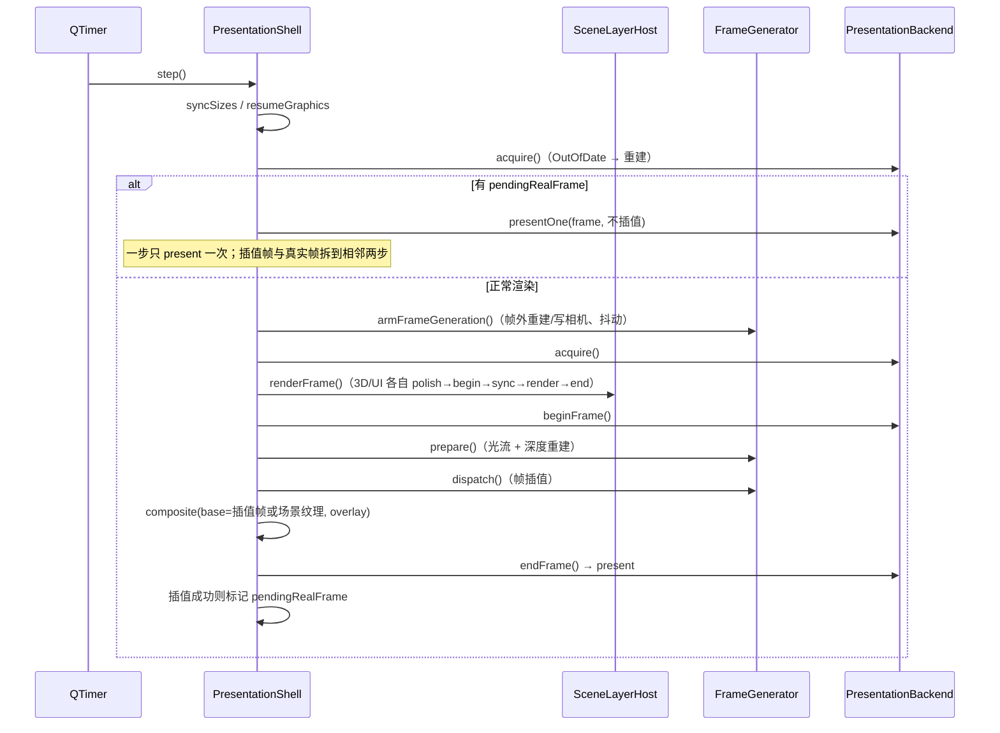
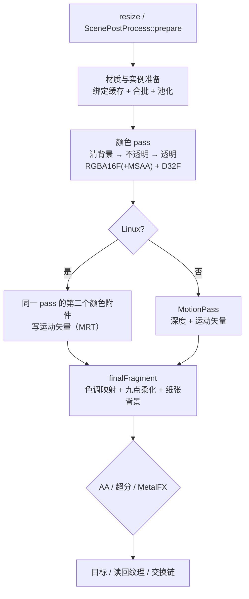

# Rhine Music Panel 渲染层架构

> 基线：`90c5c61`「fix: 编译修复」（2026-11-01）。
> 本文按当前代码重写，覆盖后端选择、两条呈现路径、唯一场景渲染器、AA/FSR/MetalFX、帧生成、
> 资源生命周期、调度策略和验证入口。文档位于被 Git 忽略的 `docs/`，只作本机开发参考。

## 本次重写相对旧文档的主要变化

- 旧文档基线为 `6d359b7`；本次更新到 `90c5c61`，按当前 `RhiScene`/`render/`/`fg/`/`fsr/` 逐段核对。
- 运动矢量在 Linux 改为颜色 pass 的第二颜色附件（单趟 MRT）；非 Linux 仍走独立的 `MotionPass`。
- FSR3 计算超分在 Vulkan 上默认关闭，默认走 FSR1 EASU/RCAS；`RHINE_FSR3_FFX=1` 才创建 FFX 计算上下文。
- 帧生成在 Linux 只有显式 `RHINE_FG`/`RHINE_FG_LAYER` 才接管呈现层；设置页已不生成 FG 动作。
  高 DPI 约定按平台拆分：Linux 物理像素离屏层，Windows/macOS 逻辑尺寸 + target DPR。
- 补充当前资源策略：内容版本/帧节拍、冷纹理准入、异步封面预处理、材质 arena、实例池、紧凑实例、
  深度不保留、Vulkan 管线缓存，以及对应测试和诊断开关。


## 1. 一页速览

```text
main.cpp
  │
  ├─ selectGraphicsBackend()
  │    Metal / Vulkan / OpenGL（D3D12 已停用）
  │
  ├─ applyVSync / Supersample / RenderScale / AA / FG 等环境变量
  │
  ├─ PresentationShell::supportsBackend(activeBackend)?
  │      │
  │      ├─ 是 → PresentationShell（受控呈现层）
  │      │       ├─ 自建 QWindow + QRhi + 交换链
  │      │       ├─ SceneLayerHost
  │      │       │    ├─ Scene3D.qml → RhiScene → sceneTexture
  │      │       │    └─ Overlay.qml → Hud/输入层 → overlayTexture
  │      │       ├─ FrameGenerator（Vulkan FgBackend / macOS MetalFX）
  │      │       └─ fgComposite → PresentationBackend → 屏幕
  │      │
  │      └─ 否 / 启动失败 → QQmlApplicationEngine::load(Main.qml)
  │               └─ QQuickWindow
  │                    ├─ Scene3D.qml（RhiScene）
  │                    └─ Overlay.qml（Hud、输入）
  │
  └─ 两条路径共用唯一的场景渲染器 RhiScene
```

关键事实：

- **只有一个场景渲染器**：`RhiScene` 负责资料库、详情页、查看封面和唱片；旧的 `OpticalScene`
  已并入，不存在第二条场景管线。
- **两条路径只差“谁持有窗口、谁做最终合成与呈现”**：默认路径由 `QQuickWindow` 完成；
  受控路径由 `PresentationShell` 自己 acquire/present。
- **Linux 的帧生成是显式选项**：只有 `RHINE_FG=on`（或 `RHINE_FG_LAYER=on` 强制对照）才接管呈现层；
  关闭时直接走 Qt Quick 默认路径，内容帧率实测更高。Windows/macOS 在能力可用时呈现层常驻接管，
  `RHINE_FG` 只决定是否插入补偿帧。
- **FSR3 计算超分在 Vulkan 上默认不启用**：默认走 FSR1 EASU/RCAS 片元路径；需要验证 FFX 计算后端时
  显式设置 `RHINE_FSR3_FFX=1`。

## 2. 入口、后端与开关

### 2.1 启动顺序

`Qt/src/main.cpp` 在创建任何窗口之前完成：

| 顺序 | 函数 | 作用 |
| --- | --- | --- |
| 1 | `selectGraphicsBackend()` | `QSG_RHI_BACKEND` > `RHINE_GRAPHICS` > `panel/graphics-backend` > 探测 Vulkan > OpenGL；Windows 的 D3D12 已停用 |
| 2 | `applyVSyncSetting()` | `panel/vsync` / `RHINE_VSYNC`；macOS 固定 swapInterval 0 |
| 3 | `applySupersampleSetting()` | `panel/supersample` → `RHINE_SUPERSAMPLE`（1–2） |
| 4 | `applyRenderScaleSetting()` | `panel/render-scale` → `RHINE_RENDER_SCALE`（50–100） |
| 5 | `applyAntialiasingSetting()` | `panel/aa-mode`、`aa-scale`、`fsr-quality`、`fsr-sharpness`、`msaa` |
| 6 | `applyFrameGenerationSetting()` | 不再读取 `panel/fg`，默认写 `RHINE_FG=off`；显式环境变量保留为排障入口 |
| 7 | `Main.qml` / `PresentationShell` 分流 | 见第 3 节 |

### 2.2 图形后端矩阵

| 平台 | 首选 | 回退 | 说明 |
| --- | --- | --- | --- |
| macOS / iOS | Metal | 无 | `RHINE_GRAPHICS` 只接受 `metal`/`auto` |
| Windows | Vulkan | OpenGL | Vulkan 探测失败时显式选 OpenGL；D3D12 代码保留但 `RHINE_ENABLE_D3D12_BACKEND=OFF`，默认不参与 |
| Linux | Vulkan | OpenGL | 先枚举物理设备；没有 Vulkan 时回退 OpenGL |

后端选择发生在 `QGuiApplication` 创建后、任何 `QQuickWindow` 创建前。Linux 还会在创建应用实例前
读取 `panel/gpu-index`，把选卡结果落成厂商环境变量（`DRI_PRIME`、`__NV_PRIME_RENDER_OFFLOAD` 等）。

### 2.3 抗锯齿与帧生成的关系

- 抗锯齿/超分是互斥单选：非 macOS 为 `off` / `fxaa` / `ssaa` / `msaa` / `taa` / `fsr`；
  macOS 为 `off` / `metalfx`。
- 帧生成是独立开关，不属于 AA 模式；它复用场景的深度与运动矢量，但 UI 永远不参与插值。
- 当前设置页已不生成 `fg` 动作；旧偏好或残留点击会被忽略。只有显式 `RHINE_FG=on`
  （以及 Linux 的 `RHINE_FG_LAYER=on` 强制接管）会启用帧生成路径。

## 3. 两条呈现路径

### 3.1 默认路径：Qt Quick 窗口



- `Scene3D.qml` 只包含一个 `RhiScene`；`Overlay.qml` 只包含 HUD、输入层、原生输入框和窗口装饰。
- `RhiScene` 开 `setAlphaBlending(true)`；场景图合成、焦点和平台输入由 Qt Quick 负责。
- 默认路径下 `Main.qml` 直接承载两层，`Overlay.qml` 通过注入的 `stageScale`/`stageWidth` 保持原舞台坐标。

### 3.2 受控呈现路径：`PresentationShell`



关键点：

- 两个离屏层必须共用同一个 `QRhi`（`QQuickGraphicsDevice::fromRhi()`）。否则 FG 无法直接采样 3D 纹理；
  `SceneLayerHost::start()` 会检查 `QQuickRenderControl::rhi() == rhi`，不匹配直接失败并回退。
- UI 层单独渲染并按显示帧率叠加；插值只作用于 3D 层，文字和按钮不会重影。
- 合成公式固定为预乘 alpha 的 source-over，与 Qt Quick 默认窗口一致。
- 两个离屏窗口都不能 `show()`；它们没有原生窗口，只用于 `QQuickRenderControl`。

### 3.3 高 DPI 与平台坐标约定

这是当前代码最容易踩错的地方，平台并不完全一致：

| 平台 / 后端 | 可见窗口尺寸 | 离屏窗口尺寸 | 离屏 target DPR | 根条目缩放 |
| --- | --- | --- | --- | --- |
| Windows | 逻辑尺寸 `m_size` | 逻辑尺寸 | `m_ratio` | 1.0 |
| macOS / iOS（Metal） | 逻辑尺寸 `m_size` | 逻辑尺寸 | `m_ratio` | 1.0 |
| Linux（Vulkan / OpenGL） | 逻辑尺寸 `m_size`，交换链用 `pixelSize()` | 物理尺寸 `pixelSize()` | 1.0 | `m_ratio` |

- `PresentationShell::pixelSize()` = 逻辑尺寸 × `devicePixelRatio`，只用于交换链和 FG 的输出尺寸。
- Linux 保持“物理像素离屏层”：`SceneLayerHost::applyLayerGeometry()` 在非 Windows、非 Metal 时把
  离屏窗口放大到物理像素，根条目按 `m_ratio` 缩放；这是当前刻意保留的行为，不要统一成全局逻辑坐标。
- 输入坐标始终是逻辑舞台坐标；`Overlay.qml` 用 `stageScale` 换算。混淆逻辑/物理像素会表现为点击错位、
  文字发糊或只画左上角。

### 3.4 每步呈现时序



调度细节：

- Vulkan 路径的内容脏检查用 `SceneLayerHost::contentDirty()`、`Engine` 的 `steps` 代次和内容版本；
  静止时可降频到 100ms 一步。`RHINE_PRESENT_CONTENT_ONLY=1` 可切换成严格按 HUD/场景更新代次判断。
- `RHINE_PRESENT_ALWAYS` 默认开启：没有新内容也继续上屏，避免 presented 从约 46/s 掉到 31/s；
  设为 0 可退回“没有新内容就不上屏”的省电行为。
- 交换链重建后的前两帧不插值，避免跨尺寸插出整屏错色。
- `Suboptimal` 只记录不重建；`OutOfDate`、Resize/Expose、DPR 变化才触发重建。
- Linux 的 `scheduleNext(0)` 若已有一步排队，只记录 `m_wakePending`，当前步结束后补跑，避免丢唤醒。

### 3.5 退出顺序

`Ctrl+Q` 在 `Overlay.qml` 里触发 `Qt.quit()`：

- 默认路径由 `QQmlApplicationEngine::load()` 接上的 `QQmlEngine::quit` 结束事件循环。
- 受控路径由 `main.cpp` 把 `QQmlEngine::quit` 接到 `PresentationShell::requestQuit`；
  后者通过 `DeferredWindowTransition` 等当前输入/QML 回调退出，再执行 `shutdown()`。
- `shutdown()` 的顺序固定：停定时器 → `RhineFg::setEnabled(false)` → `m_rhi->finish()` →
  释放交换链资源 → 释放 FG → 断开离屏 QML → 释放 SceneLayerHost → `m_presenter->release()`。
- 交换链必须先于原生窗口销毁；反过来的话 Wayland/X11/Win32 的 WSI 会对已销毁的 surface 做
  roundtrip，退出时 SIGABRT/SIGSEGV。`PresentationShell` 把原生窗口留到析构阶段就是为了这个顺序。

## 4. 唯一场景渲染器：`RhiScene`

文件：`Qt/src/RhiScene.cpp`（`RhineRendering::Renderer` + `ItemRenderer`），QML 入口：
`Qt/qml/Scene3D.qml`。离线 `renderReference()` 复用同一个 Renderer，通过离屏 QRhi 读回 RGBA8，
因此截图、对比图和窗口路径共享同一套材质与 pass。

### 4.1 输入帧协议与同步缓存

`ItemRenderer::synchronize()` 从 `Engine` 取：

- `Engine::frame()`：`QJsonObject`，包含相机 `projection`/`view`/`aoProjection`、`draws`、
  `background`、`mode`、`viewer`、`jitter`、`temporalReset`、`discAngle`、`batchDraws`、
  `fogNear`/`fogFar`/`focus`/`aperture` 等；
- `Engine::drawBuffers()`：实例矩阵、主题值和实例 id；
- `Engine::current()` / `cover()` / `musicTextures()`：当前曲目、封面和仍在归位的旧唱片；
- `RhiScene::lightingEnabled()`、`Engine::geometryRevision()`、`Engine::sceneRevision()`。

同步缓存：`SceneSyncCache.h` 的 `SceneSyncSignature{revision, geometryRevision, lighting}` 不变时
直接复用上一份 `frame`/`buffers`/`item`/`cover`，避免 HUD 变化时重复复制整个场景 JSON。
`noteSceneConsumed(sceneRevision)` 只写原子序号，再经队列回到主线程，供 `FramePacingPolicy` 对账。

### 4.2 渲染尺寸与目标

非 macOS 由 `ScenePostProcess::renderSize()` 计算；macOS 由 `RenderConfiguration::Settings::renderSize()` 计算：

```text
renderSize = displaySize × RHINE_SUPERSAMPLE(1–2)
                         × RHINE_RENDER_SCALE(50–100%)
                         × (ssaa ? RHINE_AA_SCALE(100–200%) : 1)
                         ÷ FSR 档位倍数（仅非 macOS、FSR 模式）
displaySize = 窗口物理像素
```

FSR 档位倍数：`native` 1、`quality` 1/1.5、`balanced` 1/1.7、`performance` 1/2、`super` 1/3。

`Renderer::resize()` 只分配场景所需的颜色/深度和参考读回目标；没有阴影、法线、AO、景深、
玻璃抓屏金字塔等旧中间目标。

| 目标 | 尺寸 | 格式 | 用途 |
| --- | --- | --- | --- |
| `color` | render | RGBA16F；MSAA 时多重采样 + 单采样 resolve | 唯一场景颜色 |
| `depth` | render | D32F，与 color 同采样数 | 深度测试、时域/插帧输入 |
| `motionVectors`（Linux） | render | RGBA16F，单采样 | 与颜色同趟 MRT 输出运动矢量 |
| `target` | display | RGBA8 | 仅离线 `renderReference()` 的读回目标 |
| `ScenePostProcess.m_input` | render | FSR 时 RGBA16F，否则 RGBA8 | 最终合成输入 |
| `ScenePostProcess.m_output` | display | RGBA16F | FSR 升采样输出 |
| `ScenePostProcess.m_history[2]` | render | RGBA16F | TAA 历史双缓冲 |
| `MotionPass`（非 Linux） | render | D32F + RGBA16F | 独立的深度/运动矢量 pass |
| MetalFX 输出 | display | 由 MetalFX 决定 | macOS 时域结果 |

重建条件：`viewSize`、`renderSize`、MSAA 采样数、`RHINE_AA_MODE`、是否分配运动矢量目标、
深度 store 策略任一变化。Linux 重建目标时还会清空上一帧 VP/实例矩阵历史。

### 4.3 场景资源与烘焙材质

构造时加载：

- 几何：`archive-cassette.bin` / `archive-assembly.bin` 及索引/部件表；
- 表面图集：`archive-baked-surface.bin`（1024²，完整 mip；可用时优先 `archive-baked-surface-bc7.bin`）；
- 光场：`archive-baked-light.bin`（576×96×24 的 RGBA8 三维纹理，硬件三线性采样）；
- 法线响应：`archive-baked-normal.bin`（128×256 RGBA16F）；
- 程序化贴图：盒体装饰高/低两档、封套前后文字、占位封面；
- 唱片网格：`DiscGeometry` 生成盘面、盘体、中心环。

表面/光场以 sRGB8 存储线性辐亮度/4，着色器手工解码后乘回 4；法线响应保留 RGBA16F。烘焙脚本为
`scripts/bake-archive-lighting.py`，构建期生成到 `output/resources/`。

材质统一走 `opticalSurface.frag`。`Surface` 结构 128 字节：

```text
color, physical（roughness/metalness/transmission/thickness）,
optics（ior/attenuationDistance/Index_Inlay/sharpCover）,
attenuation, extra（clearcoat/clearcoatRoughness/disc cos/sin）,
flags（材质类型/side/subdued/floor）, darkColor, emission
```

材质类型：

| type | 含义 |
| --- | --- |
| 0 | 默认/实例化材质 |
| 1 | 曲目标签/文字平面 |
| 2 | 非实例化几何（主角/调试着色） |
| 3 | `Frosted_Polymer` / `Optical_Film` |
| 4 | `Ivory_Edges` |
| 5 | `Optical_Diffuser` |
| 6 | 唱片盘面 |
| 7 | 盒体装饰文字/铭牌 |
| 8 | 唱片盘体/中心环 |
| 9 | 光学薄膜/玻璃 |

全局 UBO `Globals`：非 Linux 704 字节，Linux 832 字节（额外包含上一帧/当前 VP，用于单趟运动矢量）。
`Instance`：非 Linux 80 字节（model + state），Linux 144 字节（额外 `previousModel`）。顶点为 32 字节
（位置、法线、UV）。

### 4.4 绘制列表与批次

`musicDraws()` 做三件事：

- 剔除 `Internal_Ceramic`、`Amber_Optical_Inlay`、`Champagne_Index`、`Printed_Label` 等穿帮部件；
- 让 `Optical_Film*` / `Optical_Glass*` 走透明队列、关闭深度写入，保留唱片表面的高光/厚度层；
- 把壳体改为烘焙外观：`transmission=0`，未选中的实例化壳体单面剔除，选中 `Frosted_Polymer` 透明
  （资料库 0.62、详情 0.20、查看器 0.14），并按 selected 状态补出盘面、银色盘体、中心环和封套标记。

`prepare()` 复用 `MaterialSlotKey{id, mesh, name}` 查材质；不透明批次按几何/材质键合并，透明物体保持
`order` 排序。`geometry()` 先按管线状态分组，再提交，避免逐 draw 重复绑定。

Linux 额外资源策略（均为 Vulkan 路径，按环境变量启用）：

| 策略 | 默认 | 作用 |
| --- | --- | --- |
| 实例池 `RHINE_VK_INSTANCE_ARENA` | 开（可用时） | 多个 draw 共用一张 Dynamic VertexBuffer，按偏移切片 |
| 材质 UBO arena `RHINE_VK_UNIFORM_ARENA` | 关 | 材质槽 + 动态偏移，复用 SRB |
| 直接写 arena `RHINE_VK_DIRECT_WRITE` | 关 | `beginFullDynamicBufferUpdateForCurrentFrame()` 整块直写 |
| 布局复用 `RHINE_VK_LAYOUT_ONLY_PIPELINES` | 关 | arena 换 buffer 不重建 pipeline |
| 紧凑实例 `RHINE_VK_COMPACT_INSTANCES` | 关 | 无运动矢量消费者时用 80 字节实例 |
| 深度不保留 `RHINE_VK_DISCARD_UNUSED_DEPTH` | 关 | 无消费者时 `DoNotStore` 深度 |

### 4.5 Pass 顺序



- 没有独立的阴影、法线、AO、景深或玻璃抓屏 pass；这些由烘焙图集和材质着色器承担。
- Linux 的 `RHINE_SINGLE_PASS_MOTION=1` 让 `opticalGeometry.vert` 读 `previousModel0..3`，
  `opticalSurface.frag` 在 location 1 写 `velocityOut`；没有运动矢量消费者时使用 `surfaceNoMrt`
  变体或紧凑实例。
- 非 Linux 的 `MotionPass` 使用独立的 D32F/RGBA16F 目标，按实例 id/平移列配对上一帧矩阵；
  相机/实例都静止时跳过静态 draw 的栅格化。
- Linux 另有 `RHINE_WARP_PROBE=1` 的重投影探针：`opticalWarp*.frag` 用运动矢量把当前颜色前推到
  指定相位，用于肉眼判断拉丝/残影；它不是生产插值路径，默认关闭。

### 4.6 最终合成与平台分支

`Renderer::composite()` 先决定写入哪里：

| 平台 / 模式 | 最终合成目标 | 后续 |
| --- | --- | --- |
| 非 macOS，`fxaa` / `taa` / `fsr` | `ScenePostProcess::inputTarget()` | `ScenePostProcess::resolve()` → 目标 |
| 非 macOS，`off` / `ssaa` / `msaa` | 目标 | 无 |
| macOS，`metalfx` | MetalFX 结果 → 目标 | 无 |
| macOS，`off` | 目标 | 无 |

`finalFragment` 始终执行 ACES、九点二项核柔化（中心 4、轴向 2、对角 1，总权重 16）和纸张/暗角背景；
它不采样旧版场景、AO 或景深。

### 4.7 发布给帧生成的输入

- Linux：颜色 pass 的第二个附件直接产出 `motionVectors`，`publishMotionInputs()` 把深度/矢量/尺寸/
  相机/抖动/帧时间发布到 `RhineFg::FrameInputs`；没有第二趟几何。
- 非 Linux：`MotionPass` 产出深度与矢量，写入 `motionInputs`（Windows）或 `Engine::metalFxInputs`
  （macOS），再由 `PresentationShell` 读取。
- `serial` 每发布一次 +1；FG 宿主据此判断输入是否新鲜，避免对同一场景重复插值。

### 4.8 封面与标签生命周期

- 标签纹理按曲目 key + 标题/歌手/类型/id revision 缓存；封面纹理按 `QImage::cacheKey()` 去重，
  同专辑多曲共享同一张纹理。
- 封面/标签上限 32 个 key、64 MiB；超出后淘汰非活动纹理。封面最大 1024²，带完整 mip 链。
- 封面合成与 mip 生成在工作线程 `CoverPrepareTask` 中完成：默认同时 4 个在途、最多 16 条成品排队、
  每帧上传预算 8 MiB（`RHINE_TEXTURE_UPLOAD_BUDGET_MB`）。预处理失败会改走同步路径。
- 冷纹理准入 `MusicTextureAdmission`：焦点 key 稳定 100ms（`RHINE_TEXTURE_ADMISSION_MS`）后才创建
  标签/封面纹理，避免快速滚动时给每个路过条目都建 GPU 资源；已准入的 key 直接命中。
- `renderReference()` 强制同步封面，保证离线截图与实时路径一致；单帧参考渲染没有“下一帧”等异步结果。

## 5. 抗锯齿、超分与 MetalFX

### 5.1 模式对照

| 模式 | 平台 | 实现 | 渲染尺寸 | 时域 | 输入 |
| --- | --- | --- | --- | --- | --- |
| `off` | 全部 | 直接最终合成 | 全局倍率 | 否 | 颜色 |
| `fxaa` | 非 macOS | `aaFragment.frag` | 全局倍率 | 否 | 颜色 |
| `ssaa` | 非 macOS | 放大渲染尺寸，最终合成缩回 | × `AA_SCALE` | 否 | 颜色 |
| `msaa` | 非 macOS | 多重采样颜色/深度 + resolve | 全局倍率 | 否 | 颜色、深度 |
| `taa` | 非 macOS | `taa.frag` + 历史双缓冲 | 全局倍率 | 是 | 颜色、深度、速度、历史 |
| `fsr` | 非 macOS | FSR3 计算（可选）；否则 FSR1 EASU+RCAS | ÷ FSR 档位 | 仅 FSR3 计算 | 颜色；FSR3 另需深度、速度 |
| `metalfx` | macOS | `MTLFXTemporalScaler` | 全局倍率（≤100%） | 是 | 颜色、深度、速度 |

### 5.2 各模式流程

**`off`**：`finalFragment` 直接采样 `color` 写目标；`RHINE_RENDER_SCALE < 100` 时同时做双线性放大。

**`fxaa`**：`finalFragment` 写 `m_input`（RGBA8），`aaFragment` 做边缘检测/方向混合，输出到显示目标。

**`ssaa`**：只提高几何渲染尺寸；`sampleCount` 仍为 1，最终合成按目标视口双线性缩回。

**`msaa`**：`color`/`depth` 用设备支持且不超过 `RHINE_MSAA` 的最大采样数；`color` 额外带单采样 resolve，
后续只读 resolve 结果。

**`taa`**：`Engine` 以 Halton(2,3) 8 相位推进 `jitter`；`RhiScene` 把抖动应用进投影，`MotionPass`/MRT 用
未抖动 VP 计算速度。`finalFragment` 写 `m_input`，`taa.frag` 按速度重投影历史、3×3 邻域夹紧抑制鬼影，
0.9 历史权重混合，再 `copyColor` 到显示目标。首帧/尺寸或模式变化/`temporalReset` 时当前帧直接输出并播种历史。

**`fsr`**：

- 渲染尺寸除以档位；
- `finalFragment` 写 `m_input`（RGBA16F）；
- **FSR3 计算**：只有 `Fsr3Backend` 已建立且可用时，在 `beginExternal()`/`endExternal()` 之间派发颜色、
  深度、速度，输出 `m_output`（显示分辨率 RGBA16F），再 `copyColor` 到目标。Vulkan 上默认不创建 FFX
  计算上下文（Intel ANV 实测崩溃）；需要验证时设 `RHINE_FSR3_FFX=1`。D3D12 后端在当前构建中停用。
- **FSR1 回退**：`fsr1_easu` 升采样到显示分辨率，`fsr1_rcas` 按锐化强度换算 RCAS 档位后写目标；
  只使用颜色，不需要深度/速度/抖动。
- 计算派发失败时同一帧立即退回 FSR1，`RHINE_FSR_ENGINE` 写 `shader`；`Engine` 下一帧停止投影抖动。

**`metalfx`**：`MetalFxTemporal::resolve()` 用渲染分辨率颜色/深度、像素单位运动和 Halton 抖动输出显示分辨率；
只在 `Settings::temporal()` 为真时启用（`metalfx` + 设备支持 + `supersample × renderPercent ≤ 100`）。
设备不支持时 `implementation="metalfx-unavailable"`，画面退回 `off`，不中断渲染。

### 5.3 尺寸与质量参数

| 参数 | 影响范围 | 取值 | 说明 |
| --- | --- | --- | --- |
| `RHINE_SUPERSAMPLE` | 全部 | 1–2 | 几何渲染倍率 |
| `RHINE_RENDER_SCALE` | 全部 | 50–100% | 内部渲染百分比 |
| `RHINE_AA_SCALE` | 仅 ssaa | 100–200% | SSAA 额外倍率 |
| `RHINE_MSAA` | 仅 msaa | 2/4/8 | 目标采样数，按设备能力截断 |
| `RHINE_FSR_QUALITY` | 仅 fsr | native/quality/balanced/performance/super | 内部缩小倍数 |
| `RHINE_FSR_SHARPNESS` | 仅 fsr | 0–100 | FSR3 用 0–1；FSR1 换算 RCAS 档 |

### 5.4 抖动、历史与重置

- 抖动只服务时域方案：`taa`、可用的 FSR3 计算路径、macOS `metalfx`；FSR1 和空间方案不推进抖动。
- `Engine::step()` 在时域模式下把 `m_temporalFramesRemaining` 置 8；画面变化后的 8 帧强制标记“有变化”，
  让历史继续累积，静止后才允许休眠。
- `resetTemporalState()`（场景切换、相机跳变、尺寸变化等）清空抖动相位、请求 FSR/MetalFX reset，并在下一帧
  的 `frame["temporalReset"]` 中传递。
- 后处理目标、历史和 FSR/MetalFX 上下文都与 `renderSize`/`displaySize`/模式绑定；任一变化都会重建并作废历史。

### 5.5 限制

- macOS 没有 FXAA/SSAA/MSAA/TAA/FSR 选项，统一由 MetalFX 承担时域超分；非 macOS 没有 MetalFX。
- MetalFX 与“超采样/超过 100% 渲染倍率”互斥。
- FSR3 与 FSR1 的选择依据是编译期后端、运行期上下文和 `RHINE_FSR3_FFX`，不是用户选项；
  `RHINE_FSR_ENGINE` 只用于诊断和下一帧抖动决策。
- 帧生成不属于 AA 模式，但复用运动矢量；Vulkan 上开启 FG 时也会生成运动矢量。

## 6. 帧生成（FG）

### 6.1 算法层

- Vulkan：`FgBackend` 封装 `ffxOpticalflow` + `ffxFrameInterpolation`。两个 effect 的上下文描述都不含
  swapchain，所以算法只记录计算命令，交换链和 present 全交给 `VulkanPresenter`。
- macOS：`createMetalFxFrameGenerator()` 在系统提供 `MTLFXFrameInterpolator` 时返回实现；与 Vulkan 共用
  `RhineRender::FrameGenerator` 契约。
- 资源契约：`color` / `colorHudLess` / `output` 都是显示分辨率且格式相同；`depth` / `motionVectors` 是渲染分辨率；
  `prepare()`/`dispatch()` 必须在 `beginExternal()`/`endExternal()` 之间调用；`resize()`/`release()` 只能在帧外。

### 6.2 平台门控

| 平台 | 呈现层是否接管 | 插值条件 |
| --- | --- | --- |
| Linux | 仅 `RHINE_FG=on` 或 `RHINE_FG_LAYER=on`；否则 Qt 默认路径 | 呈现层接管且 FG 上下文可用 |
| Windows | `supportsBackend("vulkan")` 时接管 | 同上；`RHINE_FG` 决定每次是否插值 |
| macOS / iOS | Metal 常驻接管（`PresentationShell`） | MetalFX 可用且 `Settings::interpolation` 为真 |
| D3D12 / OpenGL | 不接管 | 无 FG |

`RHINE_FG` 默认 off；Linux 关闭时走默认路径内容帧率更高（实测约 +35%），所以设置页不再生成 FG 动作，
只有显式环境变量保留为排障/实验入口。`RHINE_FG_LAYER=off` 可强制默认路径。

### 6.3 每帧流程

1. `armFrameGeneration()` 在帧外读取 `FrameInputs`，按显示物理像素 resize FG 上下文，写相机/抖动/reset。
2. `recordFrameGeneration()` 在同一离屏帧内先 `prepare()`（光流 + 深度重建），再 `dispatch()`（插值）。
3. `composite()` 以插值帧为 base，叠加 UI 层（`fgComposite.frag` 的预乘 source-over）。
4. 插值帧上屏后，真实帧留到下一次 `step()` 的 `pendingRealFrame` 分支，一步只 present 一次，让事件循环
   在两次呈现之间处理输入。

`lastFrameReset()` 为真时插值结果不可用，本帧直接呈现真实颜色。

### 6.4 呈现后端

| 后端 | 实现 | 交换链 | 适用 |
| --- | --- | --- | --- |
| `RhiPresentationBackend` | `Qt/src/render/RhiPresentationBackend.cpp` | `QRhiSwapChain`（MetalSurface，可选 NoVSync） | macOS / iOS |
| `VulkanPresentationBackend` | `Qt/src/render/VulkanPresentationBackend.cpp` | 自持 `VkSwapchainKHR`，底层 `VulkanPresenter` | Windows / Linux（编入 Vulkan 呈现） |

Vulkan 同步：

- `acquire()` 取图并做一次只带信号量的空提交，把“图像可用”转成 `submitWaitSemaphore`；
- `installSubmitParams()` 在 Qt 提交前注入等待/信号信号量，渲染队列等图像、present 等渲染完成；
- `present()` 每张交换链图像一个 `renderDone` 信号量；
- 可选 `presentDeferred()` 把 present 推迟到下一次 acquire 前（同一线程），不用独立呈现线程；
- `RHINE_FG_PRESENT_SYNC=idle` 是排障通道，退回 `vkDeviceWaitIdle` + 无等待信号量的 present。

呈现模式：vsync 开启用 `FIFO`；关闭时优先 `MAILBOX`，没有则 `IMMEDIATE`。交换链图像数在非 FIFO 时略增。
Vulkan 后端还维护带设备 ID/驱动版本校验的管线缓存（`AppStorage::cacheDirectory()/shaders/qrhi-pipeline.cache`）。

### 6.5 启动自检与回退

- Vulkan 自检要求 3 秒内至少上屏 20 帧、`OutOfDate ≤ 200`；连续 5 次重建仍无新帧判死。
- iOS 使用 `PresentationStartupProbe`：只有前台窗口就绪后才开始计时，3 秒内没有首帧则 `startupFailed`。
- 任何一步失败都回退默认 `QQmlApplicationEngine::load(Main.qml)`，并把原因写入 `RhineFg::publishInactive()`；
  合成仍可继续，只是没有插值。

## 7. 调度、缓存与诊断

### 7.1 帧调度

- `Engine::FramePacingPolicy` 用“发布/消费序号”判断渲染线程是否取走上一份快照。输入永远优先；
  上一份未消费时跳过完整 step；250ms 看门狗防止窗口被遮挡时动画永久挂住。
- 引擎定时器不是固定 60Hz：动态间隔由消费状态决定；静止 750ms、场景 4 帧稳定且无 HUD 动画后休眠。
  盘面单独旋转时降到约 30Hz。`RHINE_TICK_MS` 可人为压帧。
- `sceneRevision`/`hudRevision` 只在内容真的变化时自增；`PresentationShell` 用它代替“按信号重复置脏”。
- Linux `SceneLayerHost` 默认每 20 帧补一次脏（`RHINE_LAYER_SAFETY_FRAMES`），覆盖异步资源加载没有信号的情况；
  `RHINE_LAYER_REVISION=1` 额外按 `sceneRevision`/`hudRevision` 推进置脏，但 `sceneUpdated`/`hudUpdated`
  信号和周期性兜底仍然生效，不是“只按版本号”的严格模式。

### 7.2 性能与资源计数

- `Engine::recordRender()` 汇总资源数、SRB 创建、纹理字节、封面上传、draw call、GPU 时间（含四态
  `unsupported/disabled/noSample/ok`）。GPU 计时需要创建 QRhi 时请求时间戳。
- `FrameProfiler`/性能面板读取 `RhineFg::Stats`（呈现/渲染/插值帧数、取图/场景/光流/插值/合成/整帧耗时、
  帧槽等待与分位、交换链图像/格式/呈现模式/复用间隔）和 `Engine` 的资源账本。
- 诊断环境变量：
  - `RHINE_PACE_DIAG`：引擎 tick/step/render、唤醒来源、发布/消费差；
  - `RHINE_STEP_PROBE`、`RHINE_LAYER_PROBE`、`RHINE_HUD_PROBE`：拆 step/HUD/图层成本；
  - `RHINE_FG_DIAG`：每秒 FG 计数、各层耗时、脏标记、交换链重建/等待/尺寸跳过；
  - `RHINE_POST_PROBE`：后处理路径和全屏 pass 数；
  - `RHINE_VK_RESOURCE_PROBE`、`RHINE_MEMORY_PROBE`、`RHINE_TEXTURE_PROBE`、`RHINE_MOTION_PROBE`：
    Vulkan 资源、内存、纹理准入、运动矢量配对；
  - 其他：`RHINE_DEBUG_FSR`、`RHINE_DEBUG_GPU`、`RHINE_DEBUG_DRAWS`、`RHINE_DEBUG_TINT`、
    `RHINE_DEBUG_ATLAS`、`RHINE_DRAW_PROBE`、`RHINE_GPU_PROBE`、`RHINE_KEY_PROBE`、
    `RHINE_HUD_SKIP_PAINT`、`RHINE_POST_REUSE`、`RHINE_WARP_PROBE`、`RHINE_WARP_SHOW`、
    `RHINE_FG_DEBUG`、`RHINE_FG_SWAP_IMAGES`、`RHINE_RESOURCE_BUDGET_MB`。

## 8. 配置与环境变量

| 配置 | 键 / 环境变量 | 生效时机 |
| --- | --- | --- |
| 图形后端 | `panel/graphics-backend` / `RHINE_GRAPHICS` / `QSG_RHI_BACKEND` | 仅启动 |
| 垂直同步 | `panel/vsync` / `RHINE_VSYNC`；呈现层 `RHINE_FG_VSYNC` | 仅启动 |
| 超采样 | `panel/supersample` / `RHINE_SUPERSAMPLE` | 下一帧重建目标 |
| 渲染倍率 | `panel/render-scale` / `RHINE_RENDER_SCALE` | 下一帧重建目标 |
| 抗锯齿 | `panel/aa-mode` / `RHINE_AA_MODE` | 每帧读取，立即生效 |
| MSAA | `panel/msaa` / `RHINE_MSAA` | 下一帧重建目标 |
| FSR 档位/锐化 | `panel/fsr-quality` / `RHINE_FSR_QUALITY`；`panel/fsr-sharpness` / `RHINE_FSR_SHARPNESS` | 下一帧 |
| FSR3 计算后端 | `RHINE_FSR3_FFX=1` | 运行期；默认走 FSR1 |
| 帧生成 | `RHINE_FG` / `RHINE_FG_LAYER` | Linux 接管需要重启；Windows/macOS 每次呈现读取 |
| 抖动 | `RHINE_JITTER=1` | 运行期；默认关闭，TAA/FSR3/MetalFX 会自行要求抖动 |
| 引擎节拍 | `RHINE_TICK_MS` | 排障覆盖；4–100ms，未设置时交给消费反馈和呈现侧 |
| 纹理准入 | `RHINE_TEXTURE_ADMISSION_MS` | 运行期；默认 100ms，0 关闭 |
| 封面上传预算 | `RHINE_TEXTURE_UPLOAD_BUDGET_MB` | 运行期；默认 8 MiB/帧 |
| 图层兜底 | `RHINE_LAYER_SAFETY_FRAMES` | Linux；默认 20 帧，0 恢复每帧置脏 |
| 呈现策略 | `RHINE_PRESENT_ALWAYS` / `RHINE_PRESENT_CONTENT_ONLY` | Linux/呈现层 |
| Vulkan 实验 | `RHINE_VK_UNIFORM_ARENA`、`RHINE_VK_DIRECT_WRITE`、`RHINE_VK_LAYOUT_ONLY_PIPELINES`、`RHINE_VK_COMPACT_INSTANCES`、`RHINE_VK_DISCARD_UNUSED_DEPTH` | 运行期；默认关闭 |
| 实例池 | `RHINE_VK_INSTANCE_ARENA` | 默认开；0 关闭 |

## 9. 着色器与资源清单

| 类别 | 文件 | 用途 |
| --- | --- | --- |
| 场景几何 | `enhancement/opticalGeometry.vert` | 实例化顶点、图集 UV、三维光场坐标、Linux previousModel/速度 |
| 场景材质 | `enhancement/opticalSurface.frag` | 烘焙表面、主光高光、玻璃/薄膜、盘面、Linux MRT 运动矢量 |
| 场景材质 | `enhancement/opticalSurfaceNoMrt.frag` | 无第二颜色附件时的变体 |
| 最终合成 | `enhancement/opticalQuad.vert` / `opticalFinalFragment.frag` | 全屏三角、九点柔化、ACES、纸张背景 |
| 运动 | `motion.vert` / `velocity.frag` | 非 Linux 的深度/运动矢量 pass |
| 后处理 | `quad.vert` / `copyColor.frag` / `aaFragment.frag` / `taa.frag` | 拷贝、FXAA、TAA |
| 超分 | `fsr1_easu.frag` / `fsr1_rcas.frag` | FSR1 EASU/RCAS |
| 呈现合成 | `fgComposite.vert` / `fgComposite.frag` | 插值帧/真实帧与 UI 的预乘 source-over |
| 公共 | `common.glsl` / `enhancement/opticalCommon.glsl` | 全局块、ACES、sRGB、面朝向 |
| 紧凑变体 | `Qt/shaders/compact/` | 无运动矢量消费者的 80 字节实例管线 |
| FFX 预编译 | `generated/ffx_shaders/vk/*.h` | FSR3 超分/帧生成计算着色器 |

烘焙资源由 `scripts/bake-archive-lighting.py` 生成；表面图集可输出 BC7 版本，光场是 576×96×24 RGBA8 三维纹理，
法线响应是 128×256 RGBA16F。旧的 `room-pmrem.bin`、AO/IBL 资源和实时阴影/法线/AO/景深目标不再参与自维护场景路径。

## 10. 关键约束

1. **唯一场景渲染器**：`RhiScene` 同时负责资料库、详情页、查看封面和唱片；不要再引入第二条场景管线。
2. **平台后处理二选一**：非 macOS 用 `ScenePostProcess`（FXAA/TAA/FSR），macOS 用 `MetalFX`；不会同时运行。
3. **FSR3 不是默认计算路径**：Vulkan 默认只走 FSR1；`RHINE_FSR3_FFX=1` 才创建 FFX 计算上下文。
4. **Linux 运动矢量与紧凑实例互斥**：`RHINE_SINGLE_PASS_MOTION` 写第二个颜色附件；有 motion/TAA/warp 时
   不能使用 80 字节紧凑实例，否则上一帧矩阵缺失、速度场错误。
5. **共享 QRhi**：两个离屏层、FG 宿主和呈现层必须同一设备；`SceneLayerHost::start()` 会校验。
6. **UI 不参与插值**：插值只作用于 3D 层，UI 在合成阶段按显示帧率叠加。
7. **高 DPI 不要统一**：Linux 物理像素离屏层 + 根条目缩放；Windows/macOS 逻辑尺寸 + target DPR。两者不能互换。
8. **FG 在 Linux 需要显式开启**：`RHINE_FG=on`/`RHINE_FG_LAYER=on`；关闭时走 Qt 默认路径。
9. **FG 的 resize/release 只能在帧外**：会销毁 GPU 资源并等待设备空闲；`prepare/dispatch` 在 external 段内。
10. **退出顺序**：先拆呈现层/交换链，再销毁原生窗口；否则 WSI 会对已销毁 surface 做 roundtrip。
11. **离线参考渲染强制同步封面**：参考渲染只跑一帧，没有后续帧等异步成品。
12. **Vulkan 尺寸去重必须在 `finish()` 之前**：`VulkanPresentationBackend::resize()` 同尺寸早退，否则每次同步都会
    触发一次设备空闲等待。

## 11. 验证入口

- `qt_render_policy_regression`（`Qt/tests/RenderChecks.cpp`）：GPU 计时四态、时间戳登记、AA 是否需要运动矢量、
  场景同步签名、材质槽键。
- `qt_fg_capability_regression`：FG 开关解析、能力快照、设置页三态、帧输入投递。
- `qt_music_texture_admission_regression`：冷纹理准入的边界与可见性。
- `qt_frame_pacing_regression`：发布/消费、看门狗、输入优先。
- `qt_vulkan_resource_regression`：arena/池化/深度策略的纯逻辑。
- `qt_scene_lifetime_regression`：归位卡片寿命收敛。
- `qt_offline`：原生场景、Host、音乐、GPU 离线参考（`RHINE_GPU_TEST=1` 时）。
- `qt_glyphs_regression`、`qt_native_hud_regression`、`qt_gpu_choice_regression`、`qt_platform_regression`。
- `RHINE_VISUAL_TESTS=1` 时的冻结动画/场景快照回归；`npm run test:visual` 手动运行。
- 离线测试不能替代真实 GPU、Windows/Linux 实机、显示缩放和系统集成验证。

## 12. 文件职责索引

| 路径 | 职责 |
| --- | --- |
| `Qt/src/main.cpp` | 后端选择、渲染偏好下发、默认/受控路径分流、退出顺序 |
| `Qt/src/Engine.{h,cpp}` | 场景/HUD 帧协议、抖动、内容版本、帧节拍、资源遥测 |
| `Qt/src/RhiScene.{h,cpp}` | 唯一场景渲染器（烘焙材质、唱片、AA/FSR/MetalFX、离线参考） |
| `Qt/src/render/ScenePostProcess.{h,cpp}` | 非 macOS 的 FXAA/TAA/FSR3/FSR1 后处理 |
| `Qt/src/render/MotionPass.{h,cpp}` | 非 Linux 的深度 + 运动矢量 pass |
| `Qt/src/render/MetalFxBackend.{h,mm}` | macOS MetalFX 时域超分与帧生成 |
| `Qt/src/render/PresentationShell.{h,cpp}` | 受控呈现调度、FG 装配、合成、统计与降级 |
| `Qt/src/render/SceneLayerHost.{h,cpp}` | 两个离屏 QML 层、目标与高 DPI 几何 |
| `Qt/src/render/PresentationBackend.h` | 呈现后端抽象 |
| `Qt/src/render/RhiPresentationBackend.cpp` | Metal 的 QRhi 交换链呈现 |
| `Qt/src/render/VulkanPresentationBackend.cpp` | Vulkan 呈现适配器与管线缓存 |
| `Qt/src/fg/VulkanPresenter.{h,cpp}` | 自持 `VkSwapchainKHR`、信号量注入、present |
| `Qt/src/fg/FgBackend.{h,cpp}` | FSR3 光流 + 帧插值算法层 |
| `Qt/src/fg/FgConfig.h` / `FgCapability.h` / `FgFrameTap.h` / `FgStats.h` | FG 开关、能力、帧输入、统计 |
| `Qt/src/fsr/Fsr3Backend.{h,cpp}` | FSR3 超分封装（默认 Vulkan FFX 关闭） |
| `Qt/src/fsr/Fsr1Constants.h` / `FsrSharpness.h` | FSR1 常量与锐化换算 |
| `Qt/src/render/RenderConfiguration.h` | macOS 每 Engine 的渲染设置与遥测 |
| `Qt/src/render/RenderPolicy.h` / `FramePacingPolicy.h` | GPU 计时、时间戳、节拍纯逻辑 |
| `Qt/src/render/MusicTextureAdmission.h` / `CoverPrepBudget.h` | 冷纹理准入与封面预处理预算 |
| `Qt/src/render/SceneSyncCache.h` / `MaterialSlotKey.h` | 同步签名与材质槽键 |
| `Qt/src/render/SceneResources.h` / `VulkanResourcePolicy.h` / `VulkanResourceProbe.h` | 资源所有权、arena/池化策略与探针 |
| `Qt/src/render/FrameGenerator.h` | 原生插帧算法契约 |
| `Qt/src/Glyphs.{h,cpp}` / `DiscGeometry.{h,cpp}` | 文字图集与唱片环带网格 |
| `Qt/qml/Main.qml` / `Scene3D.qml` / `Overlay.qml` | 默认路径窗口与两层边界 |
| `Qt/shaders/**` | 场景材质、最终合成、后处理、超分、运动与呈现合成 |
| `scripts/bake-archive-lighting.py` | 生成表面/光场/法线烘焙资源 |
