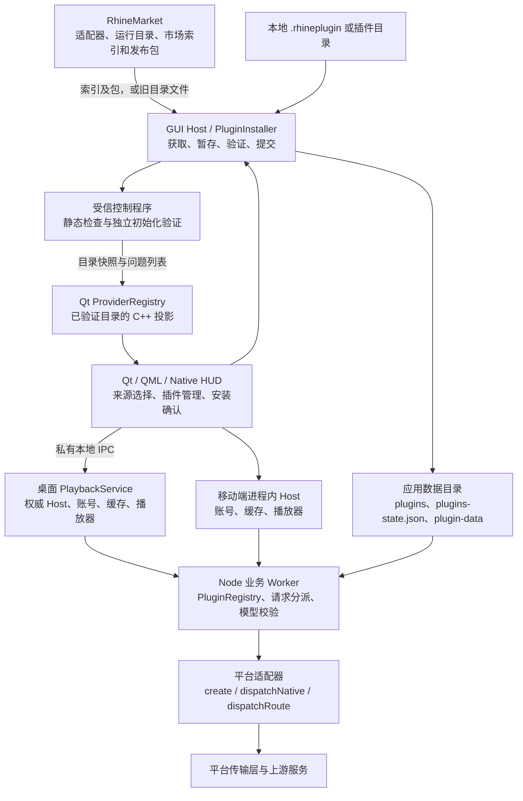
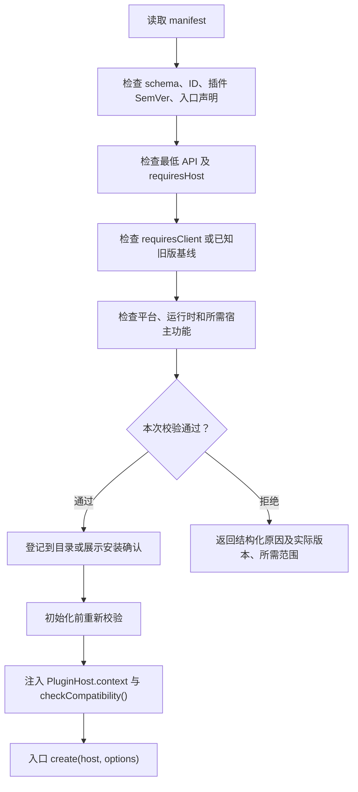
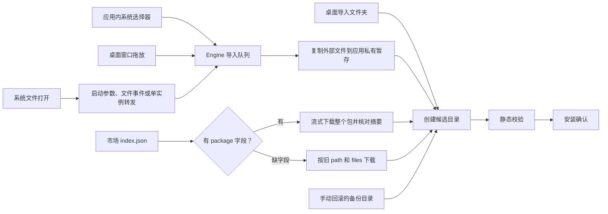
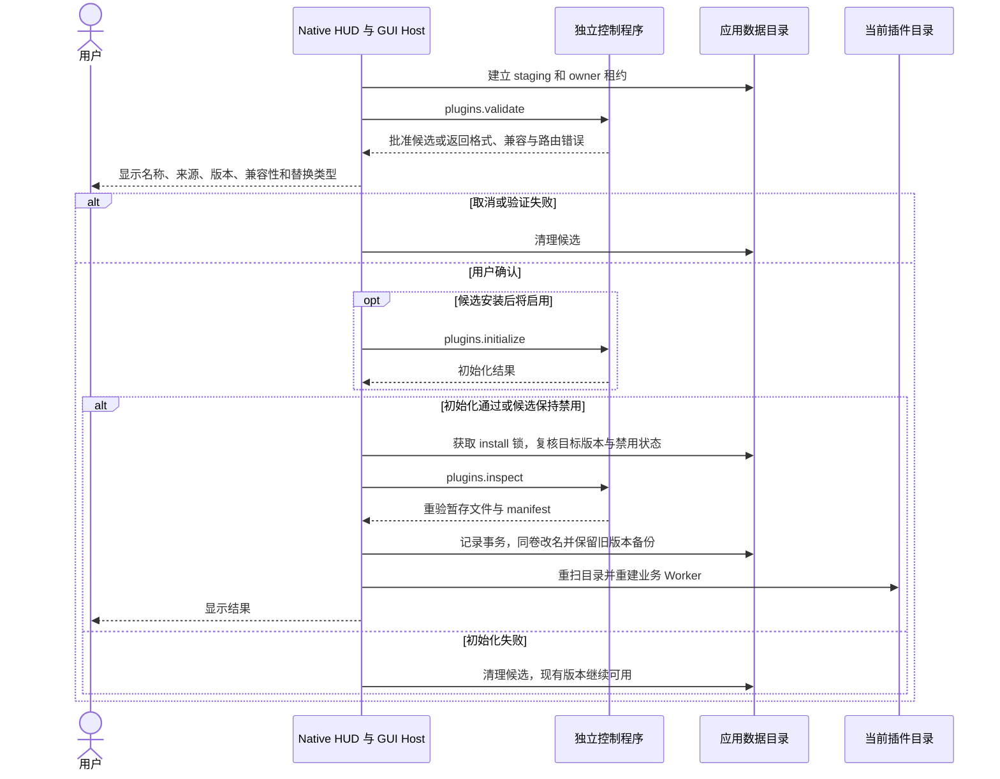
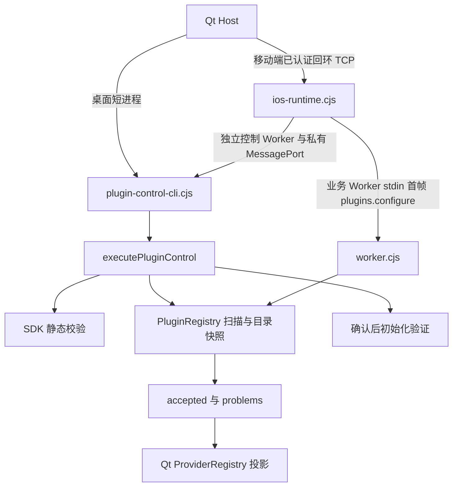
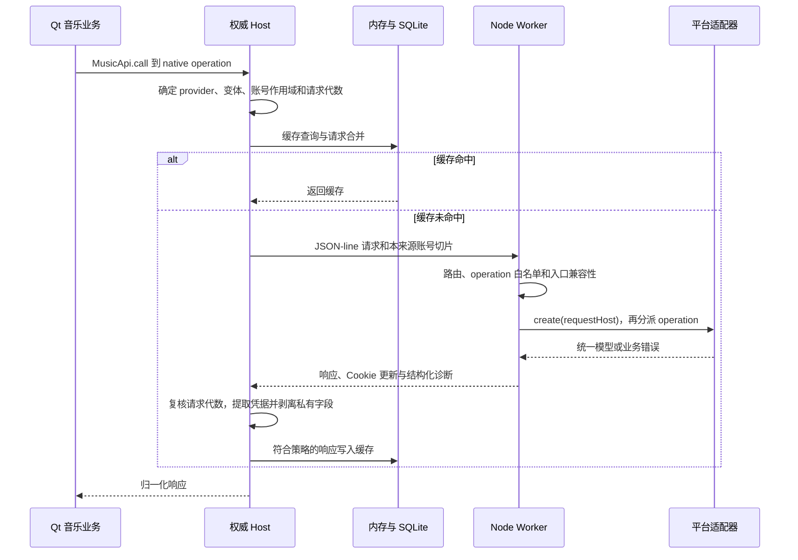

# Rhine Music Database 插件系统

本文面向维护客户端、SDK 和音乐平台适配器的开发者与智能体。当前 manifest 使用 schema 2，宿主提供 SDK API 2.1，并支持符合条件的 API 2.0 插件。接口签名、模型和字段约束以 [SDK](../MusicBridge/plugins/sdk/) 中的类型、schema 与验证器为准。平台适配器及其发布产物维护在独立的 [Rhine Plugin Market](https://github.com/MikeQu223/Rhine-Plugin-Market) 仓库。

## 1. 架构与所有权



| 层 | 职责 | 入口源码 |
| --- | --- | --- |
| Qt 业务 | 通过统一 operation 行使检索、登录、收藏、播放和歌词能力。根据 descriptor 决定界面、媒体与请求策略 | [MusicApi.cpp](../Qt/src/MusicApi.cpp)、[ProviderRegistry.cpp](../Qt/src/ProviderRegistry.cpp)、[Host.cpp](../Qt/src/Host.cpp) |
| 安装与编排 | 请求入口、网络下载、用户确认、状态持久化、同卷提交与恢复 | [HostPlugins.cpp](../Qt/src/HostPlugins.cpp)、[PluginInstaller.cpp](../Qt/src/PluginInstaller.cpp)、[Engine.cpp](../Qt/src/Engine.cpp) |
| 控制面 | 准备候选、版本比较、扫描目录、复验 manifest、执行单次初始化验证 | [plugin-control.cjs](../MusicBridge/plugin-control.cjs)、[plugin-control-cli.cjs](../MusicBridge/plugin-control-cli.cjs) |
| 运行面 | 解析路由、管理模块与适配器实例，接入 Host，分派请求并验证统一模型 | [worker.cjs](../MusicBridge/worker.cjs)、[registry.cjs](../MusicBridge/core/registry.cjs)、[host.cjs](../MusicBridge/core/host.cjs) |
| SDK 与适配器 | 主仓定义稳定的统一数据契约。各适配器持有自己的上游协议、依赖、平台规则和资源 | [SDK Port](../MusicBridge/plugins/sdk/port.d.ts)、[SDK 开发指南](../MusicBridge/plugins/sdk/README.md) |

默认构建为 Core Only，内置 `local` 与 `siren` 由 core 提供，ID 保留。可选的 `--plugins=full` 或 `--plugins=<id,...>` 从构建输入打入第三方插件。发布资源中的 `MusicBridge/local-plugins/` 是构建期插件根，运行时安装使用 `AppStorage::dataDirectory()/plugins/`。Qt 从验证器的 `accepted` 列表投影第三方 descriptor，业务 Worker 独立扫描和校验同一份 manifest。

桌面 GUI Host 管理安装界面和文件，播放服务拥有业务 Host、账号、缓存和播放状态。GUI 通过 `host.pluginCatalog` 与 `host.reloadPlugins` 取得服务确认的目录。移动端的 GUI、业务 Host 和播放器在同一应用进程，NodeMobile 在独立线程启动。有关数据路径和音频职责，见 [文件系统](文件系统.md) 和 [播放服务链](audio/service-chain.md)。

## 2. Manifest 与双向兼容

| 声明 | 校验与消费方式 |
| --- | --- |
| `schemaVersion` | manifest 布局版本，当前固定为整数 2。 |
| `id`、`version` | ID 用作安装目录、路由、凭据和缓存标识。插件版本是独立 SemVer，用于升级、降级和覆盖判断。 |
| `apiVersion`、`requiresHost` | 前者声明插件使用的最低 SDK API 版本，后者可约束宿主 SDK 范围。旧写法 `2.0` 规范化为 `2.0.0`。宿主接受同主版本、处于 `2.0.0` 至当前 SDK 版本区间的要求。 |
| `requiresClient` | 应用版本范围。新 ZIP 必填。正式构建使用 `RHINE_VERSION`，开发构建使用显式的 `RHINE_PLUGIN_CLIENT_VERSION`。未提供有效版本时，无法满足显式客户端范围。 |
| `runtime.platforms`、`runtime.hosting`、`runtime.requiresVersion` | 分别约束平台、执行模式和 Node 版本。当前实际执行模式是 `module`。NodeMobile 运行版本与桌面可以不同。 |
| `requiresHostFeatures` | 可声明依赖的宿主 `interfaces`、`operations` 和 `capabilities`。移动端宿主能力表省略 `officialPlayback` 和 `mv`。 |
| `operations`、`capabilities`、`display` | `operations` 放行插件的原生分派接口，`capabilities` 驱动 UI 与业务入口，`display` 提供名称、排序、图标等。 |
| `entry`、`files`、`routes` | 指定入口、运行文件及其摘要，以及静态声明的前缀和精确旧路由。 |
| `credentials`、`cache`、`media`、`runtime.env` | 描述账号、缓存、媒体访问及请求环境策略，由对应的宿主路径消费。 |



- 版本范围支持精确版本与 `=`、`<`、`<=`、`>`、`>=`。空格连接同组比较符，`||` 连接可替代组。预发布版需要对应核心版本的显式预发布条件。构建元数据 `+...` 不参与排序。
- 已知 schema 2、API 2.0 的旧目录和旧 USTAR 可使用兼容模式。缺少 `requiresClient` 时仅使用明确的 API 2.0 基线。旧契约下可识别历史 `kind: "community"`。未知 schema、无效 API 或无法满足的声明会阻止安装或暂停加载。
- 新版宿主在执行插件入口前完成静态判定。初始化通过 `host.context` 取得客户端版本、宿主 SDK、平台、运行时和能力表，可用 `host.checkCompatibility()` 读取相同语义的判定。需要新宿主接口的包应声明最低 API 2.1，旧客户端已有的 API 门槛会据此拒绝加载。
- 同一主版本通过可选字段和兼容接口演进，保留默认行为。破坏性 SDK 改动升级主版本，manifest 布局不兼容时同步调整 schema 版本。修改契约前检查新旧客户端与插件的组合，更新类型、schema、实现和测试后，以 `node scripts/check-contract-freeze.cjs --write` 更新 [契约锁](../MusicBridge/plugins/sdk/contract-lock.json)。SDK 版本和客户端版本独立演进。

校验实现见 [compatibility.cjs](../MusicBridge/plugins/sdk/compatibility.cjs)、[manifest-validation.cjs](../MusicBridge/plugins/sdk/manifest-validation.cjs)、[manifest.schema.json](../MusicBridge/plugins/sdk/manifest.schema.json)。

## 3. 安装包、入口和确认界面

新 `.rhineplugin` 使用 ZIP32 的 Store 或 Deflate。包根为 `manifest.json`、入口文件及声明的资源和依赖，用户收到的文件可直接离线安装。读取器按内容识别 ZIP 或历史无压缩 USTAR。新包需提供每个文件的字节数和 SHA-256，入口、图标、音质徽章及 SBOM 等声明引用须指向包内实际文件。



| 入口 | 接线和行为 |
| --- | --- |
| 桌面选择器及拖放 | `Overlay.qml` 打开选择器，`Engine::eventFilter` 接收窗口文件拖放。统一进入 `Engine::importPluginPackage` 队列。受控 Linux 原生窗口没有可用文件对话框时，通过临时 Qt Quick 窗口承载回退选择器。 |
| Windows 与 Linux 文件关联 | Windows 由 Inno Setup 注册扩展名。Linux 提供 MIME XML 和桌面入口，文件关联取决于桌面集成。启动参数可经 PlaybackService 转交现有 GUI，窗口就绪后投递。 |
| Apple 文件打开 | macOS／iOS 的 plist 声明文档类型与 UTType，`main.cpp` 接收 `QFileOpenEvent` 并等窗口就绪。iOS 保留系统提供的本地文件 URL，借 Qt 文件层读取并限额复制到沙盒快照。共享应用需把文件交给系统打开入口，也可先存入「文件」再选。 |
| Android | 共用市场、安装事务与 NodeMobile 控制面。系统文件导入范围为 Windows、macOS、Linux 和 iOS／iPadOS。 |
| 市场 | `RHINE_PLUGIN_MARKETPLACE_URL` 覆盖默认的 RhineMarket `index.json`。新字段 `package: { url, size, sha256 }` 可指定完整包，URL 按索引地址解析。校验市场 ID、版本及入口。显式指定的包下载或校验失败会显示错误。缺少该字段的旧条目仍走逐文件下载。 |

入口参考 [Overlay.qml](../Qt/qml/Overlay.qml)、[main.cpp](../Qt/src/main.cpp)、[PlaybackService.cpp](../Qt/src/PlaybackService.cpp)、[Apple iOS plist](../Qt/InfoIOS.plist.in)、[Windows 安装脚本](../scripts/windows-installer.iss)、[Linux MIME](../Resources/rhine-plugin.xml)。

**归档边界。** 读取器限定单文件 64 MiB、总解压量 256 MiB、输入容器 264 MiB、条目 512 个、manifest 256 KiB。归档路径使用 NFC UTF-8 相对路径，最长 240 字节、最多 16 层。拒绝路径穿越、绝对路径、符号链接、特殊文件、重复或大小写冲突、设备保留名、加密和 ZIP64。ZIP 中央目录、局部头及描述符要一致，实际流式解压大小和 CRC 必须符合记录。进入新包确认页前还要核对 manifest 的文件大小、摘要和完整清单。市场 SHA-256、清单摘要和 ZIP CRC 用于内容完整性，确认页单独显示发布者身份未验证。实现见 [plugin-archive.cjs](../MusicBridge/core/plugin-archive.cjs) 和 [plugin-package.cjs](../MusicBridge/plugin-package.cjs)。

## 4. 安装事务与失败恢复



1. `beginPluginInstall` 创建 `<data>/plugins/.staging-XXXXXX/` 并持有 `.owner.lock`。包、目录、旧市场下载及手动回滚统一生成 `candidate/`。`plugins.validate` 解析数据、验证环境与路由归属。已有版本通过 `plugins.compare` 与候选比较，确认页区分新装、升级、降级和覆盖。
2. 用户确认后，需要启用的候选经 `plugins.initialize` 调用真实入口。初始化在一次性进程或 Worker 内执行，注入游客 Host、临时数据目录和不可用的 Host 业务请求入口。此隔离保护账号上下文和业务 Worker 生命周期，第三方 JavaScript 仍具备宿主运行时的代码执行能力。加载约束包括 `create`、`dispatchNative`，以及声明路由时的 `dispatchRoute`。探测可调用适配器的 `dispose`。
3. `PluginInstaller::commit` 用 `.install.lock` 串行化写入。持锁时复核当前目标版本与启用状态，再同步 `plugins.inspect` 并对比用户看到的 manifest。通过后以 `QSaveFile` 提交 `.install-transaction.json`，记录 ID 及原版本、备份是否存在。
4. 当已有目标及备份时，先把旧备份移到 `.previous-<id>`，再把目标移到 `.backup-<id>`。候选最终改名为 `<id>`。启动恢复检查事务记录和目录状态，按情况恢复目标或备份并收尾。清理器回收失去租约的暂存，保留活跃暂存。普通安装失败和取消会释放租约并清理候选。
5. `plugins-state.json` 的 `disabled` 数组保存显式禁用意图。重新启用先初始化验证再写状态；更新保持原有启用意图。安装目录和备份只存插件代码与资源，插件数据放在 `plugin-data/<id>`，登录凭据由平台接口维护。手动回滚对备份同样走暂存、预检、确认、验证和提交。

源码见 [HostPlugins.cpp](../Qt/src/HostPlugins.cpp)、[PluginInstaller.cpp](../Qt/src/PluginInstaller.cpp)、[plugin-control.cjs](../MusicBridge/plugin-control.cjs)、[NativeHudController.cpp](../Qt/src/NativeHudController.cpp)。

## 5. 控制通道与插件发现



- 桌面用独立 `QProcess` 运行控制 CLI，通过单条 JSON 请求和响应收发。移动端使用 NodeMobile 与带随机令牌的回环连接，业务 Worker 和控制 Worker 分离。业务 Worker 通过 `plugins.configure` 首帧接收客户端版本、平台、用户根目录和禁用状态，规避部分 NodeMobile 构建无法可靠传递 Worker 环境选项的问题。
- 控制 Worker 用专用 MessagePort 回复，Node 父线程转成 `plugin-control-result`，Qt 按 `requestId` 匹配回调并处理超时取消。静态解包默认 30 秒，初始化 8 秒，其他控制请求 5 秒。**移动端读槽先取走待处理回复，再用排队连接交付回调**。确认回调会在同一连接上同步发起 `plugins.inspect` 或扫描目录。内联调用会让后续回复等在 Qt 的 `readyRead` 槽内，重现点击确认后的校验超时。延长超时无法解除该依赖。
- JS 注册表按用户根、构建期根的顺序扫描，目录内按名称稳定排序，跳过隐藏暂存、备份及非候选目录。有效用户插件优先占用 ID，显式禁用也会占用该 ID。若用户目录的 manifest 或入口检查失败，符合条件的同 ID 随包版本仍可能入选。重复 ID、相交前缀和与其它插件冲突的声明按注册规则报告。
- `plugins.discover` 返回 `accepted`、`problems`。Qt 只以通过静态校验的条目投影 descriptor，插件管理另读取安装记录展示不兼容项。扫描读取 manifest 和入口路径，入口执行发生在候选初始化或业务加载阶段。
- 更新、启用、禁用和回滚提交后走 `Host::reloadPlugins`。桌面通知播放服务更新目录，移动端直接重扫。宿主重建业务 Worker 并刷新相关元数据、图片缓存及限流状态，广播 `pluginsReloaded`，供来源、歌词等消费者刷新。

参考 [BridgeProcessIOS.cpp](../Qt/src/BridgeProcessIOS.cpp)、[BridgeProcessAndroid.cpp](../Qt/src/BridgeProcessAndroid.cpp)、[ios-runtime.cjs](../MusicBridge/ios-runtime.cjs)、[registry.cjs](../MusicBridge/core/registry.cjs)。

## 6. 业务请求、账号和缓存



- **路由。** Qt 通常走 `/native/<id>/<operation>`，参数通过 `params.args` 传位置参数。在兼容调用中，`/plugin/<id>/<operation>` 和 `/plugin/<id>/route/<path>` 分别调用 native 与原始路由。适配器也可按 manifest 声明精确旧路由和前缀。native operation 依赖 `manifest.operations[operation] === true`，统一返回值由 `models.cjs` 验证，底层 `request` 是例外。
- **入口与实例。** `PluginRegistry` 对 CJS 使用 `require`，其它支持的模块入口走动态导入。同一 Worker 缓存模块／`create`，每个请求使用新的适配器实例和 Host 上下文。模块顶层状态会在 Worker 生命周期内共享，适配器作者应把账号状态存在请求上下文或宿主提供的数据位置。
- **凭据。** Host 根据 provider、变体和 `credentials` 策略提取 Cookie、注入声明的 secret、替换 `runtime.env` 中的 `$variant` 与 `$dataDir`。请求发出前重新获取账号切片。响应中的声明字段按来源更新，在返回到 UI 前剥离私有字段并检查 epoch。日志保留安全错误码和诊断字段，避免记录 Cookie、token 与完整签名 URL。
- **缓存。** 请求键含 provider、策略版本、变体、账号作用域和规范化路由／参数。相同请求可合并；符合插件白名单的游客成功响应才经过磁盘落盘保护，包含凭据或敏感 URL 的响应会被跳过。插件更换和重载推进代数，防止旧请求写回当前缓存。歌词和封面使用各自存储策略。见 [文件系统](文件系统.md)。
- **失败隔离。** 不兼容条目在发现阶段跳过。业务 Worker 会记录真实入口／`create`／分派契约失败，后续请求避免重复加载该插件。标准 `/native` 和插件原始路由使用内部 `_pluginLoadFailure` 标记把加载问题同步到 Qt 插件管理。兼容 native 路由仍有独立的错误返回路径。普通 operation 错误仍是当前请求的业务结果。进程内执行的适配器共享 Node 资源，单个插件的死循环或原生崩溃仍可能影响所在 Worker 或进程。schema 中的 `network`、`limits` 和 `routes.rawRoutes` 目前是声明字段，运行时不会据此实施通用网络隔离、资源配额或原始路由白名单。

## 7. 构建、发布和维护入口


- 主仓 `scripts/bundle-plugins.cjs` 面向应用便利构建。构建脚本分别生成桌面和移动端桥接产物，业务 Worker 与控制 CLI 同时随应用部署。移动端以 Node 18 兼容目标打包。常规客户端发布采用 Core Only。
- 在 RhineMarket 运行 `node scripts/release-plugins.cjs build`。它复用主仓 SDK 校验器、CLI 和 esbuild，检查兼容性、摘要、市场清单与可解析依赖，产物直接写到 `plugins/` 下。打包是静态流程，插件试装由用户在客户端确认。动态依赖和设备能力由适配器测试及实机验证补充。
- 市场 workflow 固定主仓 SDK 提交，生成可下载的包。发布者显式启用 Release 步骤后先发布附件，再以远端附件的大小、SHA-256 和 URL 核对产物，生成供维护者审核的索引候选。旧索引中的目录与文件清单供较早客户端使用。
- 主仓可独立运行 `npm run plugin:package -- pack <目录> --out <产物>` 与 `npm run plugin:package -- verify <产物>`。CLI 的 `install` 与 `rollback` 是需显式传安装目录的独立命令。Qt 安装器负责客户端确认和可恢复事务。

### 按改动类型定位

| 要做的改动 | 起点与验证 |
| --- | --- |
| 新增或调整某个平台能力 | 在独立仓库修改 manifest、适配器和 transport。以 SDK Port 确认参数与模型，执行该平台离线测试和市场打包校验。只有需要通用接口时才改主仓。 |
| 修改通用 operation | 顺着 `MusicApi`、worker 路由、`port.d.ts` 和 `models.cjs` 核对请求与结果，检查对应 Qt 消费者，再更新契约锁与回归。 |
| 修改安装或文件交付 | 从 `Engine` 与系统文件入口定位交付，再追到 `HostPlugins`、归档验证器和安装事务。使用相同包分别验证本地与市场入口。 |
| 修改登录或缓存策略 | 先看 manifest 的 `credentials`、`cache` 及对应消费者。核对变体、账号作用域、请求代数和错序响应，使用匿名 fixture 验证。 |

### 排查与验证

| 现象 | 优先检查 |
| --- | --- |
| 市场有条目，校验失败 | `index.json` 的 ID、版本、入口和包摘要是否与真实附件一致。使用 CLI 回读 ZIP，检查清单与实际文件。 |
| 本地包出现版本不兼容 | 查看实际客户端版本和当前 SDK。开发构建需要有效的 `RHINE_PLUGIN_CLIENT_VERSION`；移动端确认 Node 版本与宿主能力。 |
| 已安装但看不到来源 | 比对用户根与构建期根、`plugins-state.json`、`accepted` 和 `problems`，检查入口、重复 ID、路由冲突与暂停原因。 |
| 点击确认后超时 | 区分初始化、同步复验与目录重扫。移动端检查控制回调是否脱离 socket 读槽、`requestId` 能否收发，以及候选初始化针对移动 Node 是否成功。 |
| 面板显示支持但 operation 失败 | 分别检查 `capabilities`、`operations`、SDK Port 的位置参数、适配器分派实现和统一返回模型。 |
| 更换账号或插件后结果过期 | 检查凭据作用域、插件缓存版本、epoch 和对应缓存写回条件。避免把账号状态留在模块级全局变量。 |

```bash
npm run check:contract-freeze
npm run check:provider-literals
node --test scripts/test-plugin-registry.cjs scripts/test-plugin-package.cjs scripts/test-ios-bridge-plugin.cjs
node scripts/check-marketplace.cjs /path/to/RhineMarket/index.json
ctest --test-dir output/qt-build --output-on-failure -R '^qt_(offline|native_hud_regression)$'
```

- [NativeHostChecks.cpp](../Qt/tests/NativeHostChecks.cpp) 覆盖本地 ZIP、市场安装、旧目录、确认、更新失败与事务恢复。[NativeHudChecks.cpp](../Qt/tests/NativeHudChecks.cpp) 检查插件管理和重载，[PlaybackServiceChecks.cpp](../Qt/tests/PlaybackServiceChecks.cpp) 检查桌面单实例转发。
- [IOSBridgeChecks.cpp](../Qt/tests/IOSBridgeChecks.cpp) 包含嵌入式 Worker、会话切换和确认后同步复验的回归。桌面 Node 结果能覆盖协议和归档，平台文件关联、外部文件授权与 NodeMobile 仍需在相应系统上验证。
- 修改安装边界时，同时覆盖损坏 ZIP、恶意路径、符号链接、错误摘要和失败后旧版本。修改版本契约时，同时测试旧 API、目标客户端升降级、预发布和开发构建。修改分派时，复核 operation 声明、模型、普通业务错误与加载失败的区别。

历史基线工具 `check-plugin-contracts` 和 `check-core-boundary` 只处理显式提供的 `RHINE_PLUGIN_BASELINE`，供仍持有旧基线的维护者使用。当前工作流运行契约锁、provider 字面量及实际离线回归。
