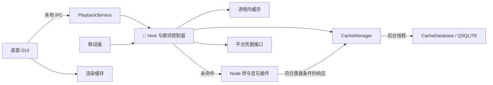
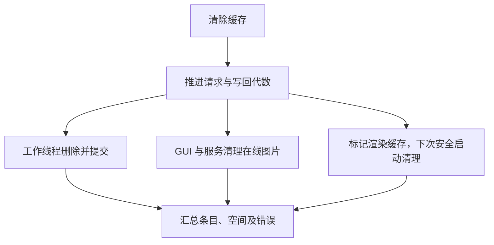

# 文件系统

`AppStorage` 统一解析路径，具体文件仍由各业务模块维护。下表的路径均相对于对应的根目录。

| 根目录 | Windows | macOS、Linux、iOS |
| --- | --- | --- |
| 数据 | 程序旁的 `data/` | `QStandardPaths::AppLocalDataLocation` |
| 缓存 | `data/cache/` | `QStandardPaths::CacheLocation` |
| 临时文件 | `data/temp/` | Qt 返回的系统或应用临时目录 |
| 设置 | `data/settings.ini` | 原生 `QSettings` |

Windows 使用可执行文件所在目录定位绿色版数据，支持中文路径和从其他工作目录启动。数据根或临时目录无法建立时，启动会报告错误。缓存子目录建立失败时，业务可走内存及原有请求路径。Android 桥接运行时可优先使用 Qt 提供的应用缓存目录作为临时目录。

| 内容 | 位置或机制 | 写入者 |
| --- | --- | --- |
| 设置及历史 | `QSettings` 的 `panel` 组 | 桌面多数偏好由服务代写。搜索历史由资料库维护，播放历史由播放器维护。移动端由同一进程写入 |
| 浏览与界面会话 | 数据根的 `session.json` | GUI 写入；移动端也用此文件保存播放状态 |
| 桌面播放会话 | 数据根的 `playback-session.json` | PlaybackService 周期性提交快照，后台线程使用 `QSaveFile` 写入 |
| 本地曲库和收藏 | 数据根的 `local-library/index.json`、`local-library/covers/`、`collections/` | 本地曲库和收藏模块 |
| 插件安装和私有数据 | 数据根的 `plugins/`、`plugins-state.json`、`plugin-data/<provider>/` | 插件管理入口和插件运行时 |
| 账号凭据 | macOS／iOS Keychain；Windows `account.dpapi`；Linux `account.credential` | 平台凭据接口。Linux 依赖文件权限，Android 依赖应用沙箱 |
| 元数据和歌词 | 缓存根的 `cache.sqlite`，运行中可见 `-wal`、`-shm` | 桌面 PlaybackService，移动端进程内 Host |
| 在线封面 | 各 Host 实例的有界内存缓存，默认 32 MiB；系统媒体控件可使用 `media-cover.png` | GUI 和服务分别持有内存缓存，媒体控件封面由播放端生成 |
| 渲染缓存 | 应用管理的 `qml/`、`shaders/`；Qt 还可能使用平台默认路径 | GUI 和渲染后端 |
| 音频和桥接临时文件 | `rhine-stream-*`、`rhine-music-*` 等 | `HttpAudioStream` 与桥接进程的生命周期对象 |

源码：[AppStorage](../Qt/src/AppStorage.cpp)、[MusicSession](../Qt/src/MusicSession.cpp)、[PlaybackService](../Qt/src/PlaybackService.cpp)、[LocalMusicLibrary](../Qt/src/LocalMusicLibrary.cpp)、[LocalCollections](../Qt/src/LocalCollections.cpp)、[HttpAudioStream](../Qt/src/HttpAudioStream.cpp)。

## 🔄 一次缓存请求怎么走

- **元数据：**Host 先查内存。首次未命中的请求建立去重任务，再异步查盘。同一代的重复请求加入任务。查盘未命中后沿用现有网络队列和限流。磁盘键包含命名空间、来源、游客作用域、插件缓存版本，以及对路由、参数和平台变体编码后的 SHA-256 摘要。请求参数排除 `timestamp`。失效代数保留在进程内。
- **歌词：** 正文记录的键包含曲目平台与 ID、实际歌词来源及来源曲目 ID、选择方式、语言、变体。本地曲目还带指纹。自动匹配另有选择记录，指向具体正文。命中时先读选择，再读正文。正文只保存歌词协议字段。当前显示的歌词独立于缓存条目。
- 在线登录请求默认只使用内存。元数据还需要插件声明游客落盘白名单、成功响应及载荷检查。响应中有 Cookie、凭据字段或带查询参数的 HTTP 地址等情况会跳过磁盘写入。歌词依赖游客作用域及协议字段投影。账号凭据仍由平台接口持有。

源码：[Host](../Qt/src/Host.cpp)、[LyricsController](../Qt/src/LyricsController.cpp)、[CacheManager](../Qt/src/storage/CacheManager.cpp)。

## 🗄️ SQLite 文件与容量

| 项目 | 当前实现 |
| --- | --- |
| 记录结构 | `cache_entry(namespace, provider, scope, version, request, payload, bytes, expires, accessed)`。前五列组成主键。过期和 LRU 各有命名空间索引，`user_version=1` |
| 并发 | CacheManager 在工作线程串行调用 QSQLITE。数据库创建、查找、写入、删除、统计及维护走该线程 |
| 单写入者 | `cache.sqlite.lock` 保护数据库写入者。桌面服务另持有 `playback-service.lock`。GUI 断连时不直接打开共享库 |
| 淘汰 | 命中不延长 TTL。访问时间至少间隔 60 秒才写回。写入事务先删除过期条目，再按最近访问顺序淘汰 |
| 载荷配额 | 元数据默认 256 MiB，歌词默认 64 MiB。Qt 设置 `storage/metadata-quota-mib`、`storage/lyrics-quota-mib` 下次启动生效，范围分别为 0–256 和 0–128。0 禁止该类别查盘及写盘，单条载荷最大 8 MiB |
| 🎼TTL | 元数据取插件策略；新歌词 30 天；可确认来源的旧本地歌词迁移记录 7 天 |
| 空间口径 | `logicalBytes` 是记录载荷之和，`fileBytes` 包括主库、WAL 和 SHM。清理后独立报告观察到的缩减量。SQLite 可保留空页供以后复用 |
| 降级 | 驱动缺失、打开失败或目录不可写时返回缓存未命中。开启失败至少间隔 30 秒重试。数据库损坏时保留原文件，继续处理请求和歌词 |

主库配置了页数上限。清理提交后尝试增量回收和 WAL checkpoint。WAL 的保留大小配置约束 checkpoint 后的保留量，运行中的写入仍可能临时增加磁盘占用。

源码：[CacheDatabase](../Qt/src/storage/CacheDatabase.cpp)、[CMake](../CMakeLists.txt)。

## 🧹 清理与升级

- **清除缓存**通过 `storage.clearCaches` 协调 GUI 与服务。服务发出 `storage.invalidated` 通知其他客户端。旧请求仍可完成业务交付，清理后的写回受代数限制。渲染适配器写入 `clear-render-cache` 标记，持锁的 GUI 在渲染初始化前兑现。当前播放临时文件由音频流释放。
- **清除历史**通过独立的 `storage.clearHistory` 清除搜索和播放历史。设置、凭据、会话、曲库、收藏和插件数据保持原有归属。完整应用数据重置尚无独立入口。
- **旧歌词**读取 `panel/lyrics-cache`，校验可明确识别的本地记录，将其保存到 `legacy-local` 作用域。确认写入、回读及旧值未变后移除对应旧项。迁移记录与新版正常命中隔离。来源或账号不明的旧在线记录保留，用户主动清缓存时可移除。
- **旧元数据**停止读取旧文件，只枚举专用 `metadata/` 中符合 64 位十六进制文件名的 JSON 普通文件，并跳过符号链接。
- **服务重启**沿用原有重开应用路径。新服务取得进程锁后接管。缓存连接交给 SQLite 恢复已提交的 WAL。

源码：[StorageCoordinator](../Qt/src/storage/StorageCoordinator.cpp)、[PlaybackConnection](../Qt/src/PlaybackConnection.cpp)、[RenderCacheStorage](../Qt/src/storage/RenderCacheStorage.cpp)。
