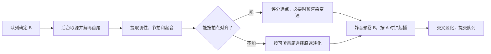
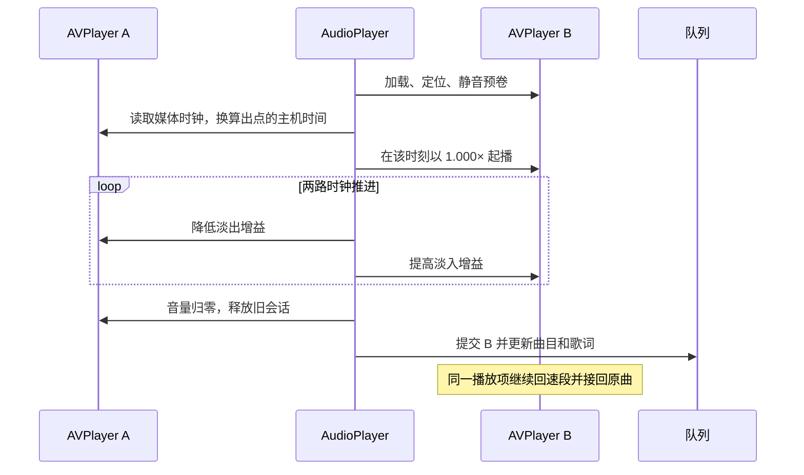

# 自动过渡

根据音乐调性和拍速，在合适的时间点衔接相邻歌曲。

macOS/iOS 使用 AVPlayer；Windows 使用现有 Qt 解码与 PCM/WASAPI 输出。设置里的“自动过渡”默认关闭，两种实现共用调性、拍点选择、保音高预渲染、回速曲线和队列交接逻辑。能力由 `PlatformFeatures::AutomaticTransition` 声明。

下文用 A 表示当前曲目，用 B 表示下一首。转场计划记录 A 出点、B 入点、叠播时长和 B 切入速度。出入点使用各自的原曲坐标，叠播时长使用实际播放经过的时间。

## 何时准备下一首

当前曲目开始稳定播放且时长已知后，播放服务立即根据队列确定下一首。进入随机模式时保留正在播放的曲目并一次性打乱其余队列。本轮沿打乱后的顺序播放，因此预载与实际下一首使用同一个索引。单曲循环、时长短于 8 秒的当前曲目、无下一首、同曲或跨来源的下一首会走普通播放流程。

本地歌曲直接读文件。在线歌曲通过当前平台的播放接口取址，在后台并行准备两首歌的分析素材。上一轮保留的缓存可用作当前曲目的分析输入。现有缓存支持可下载的 HTTP 音频和符合条件的 HLS 点播，每份媒体上限为 96 MiB，取源时限随当前剩余时间调整，最多 14 秒。直播 HLS、加密清单、字节范围分片和不连续分片无法使用这条缓存分析路径。

暂停或跳转可以撤销定时起播，同一歌对的取址与分析结果仍可复用。队列、来源或播放代次变化时，旧任务失效，避免过期结果切到错误的歌曲。 [队列](../Qt/src/PlaybackQueue.cpp) · [预载入口](../Qt/src/MusicPlayer.cpp) · [流媒体缓存](../Qt/src/AppleTransitionMedia.cpp)

## 怎样找到切换点

### 特征提取

解码器读取 A 末尾和 B 开头，各最多 **20 秒**，每 10 毫秒统计一帧。

| 特征       | 计算方式                                                                                        | 用途                                                           |
| ---------- | ----------------------------------------------------------------------------------------------- | -------------------------------------------------------------- |
| 可听范围   | 跨声道计算每帧 RMS，定位首末超过阈值的帧                                                        | 估计可听首尾、弱起强度和原速淡化长度                           |
| 三频带起音 | 用约 170 Hz 和 2.1 kHz 的低通分出低、中、高三段，取各段对数能量的正向变化                       | 以 0.50、0.32、0.18 加权合成节拍序列，另保留三频带数据用于对齐 |
| 调性       | 半音能量按八度折叠成 12 个音级，与 24 个大小调模板做归一化相关                                  | 最高分不足 0.60 或领先次高分不足 0.025 时记为未知              |
| BPM 和拍点 | 在分析窗前后两半分别对平滑后的起音序列做自相关，搜索 300 至 1000 毫秒的拍周期，再细化周期与相位 | 生成带置信度的拍点网格                                         |
| 小节首拍   | 检查两半窗口是否都在同一个四拍位置出现稳定重音                                                  | 可靠时优先对齐小节首拍                                         |

主音和调式相同、同调式的四度或五度关系、关系大小调均允许较长叠播，未知调性也进入这条路径。已识别的调性冲突跳过小节首拍方案，缩短普通对拍叠播。

### 候选点与评分

A 在曲尾 **20 秒**内找出点，B 在开头 **20 秒**内找入点和对齐拍。B 可以直接从候选拍起播，也可以保留拍点之前的弱起，同时把 A 的出点提前，让目标拍对齐。先用完整分析窗的网格，失败后再组合 A 尾部和 B 头部约 14 秒的局部网格。

设 A 和 B 的拍间隔为 `P_A` 和 `P_B`，B 的切入速度为 `r = P_B / P_A`。普通拍点另比较该比例乘以 0.5 或 2 的倍拍解释，最终只接受 **0.84× 至 1.16×**。例如 A 为 120 BPM、B 为 104 BPM，按同拍匹配时 B 以约 `1.154×` 切入。

从对齐拍起，用 `B 帧偏移 = A 帧偏移 × r` 比较最多约 1.2 秒的三频带起音。相似度是两组加权起音的归一化点积。先排除低于门槛的候选，再取同一策略内的最高分。

| 搜索顺序               | 相似度门槛                             | 评分因素                                                             |
| ---------------------- | -------------------------------------- | -------------------------------------------------------------------- |
| 小节首拍对齐           | 0.09                                   | 偏好约两个小节的叠播，惩罚跳过弱起、提前起播和偏离目标时长           |
| 普通拍点对齐           | 双方拍点相位可靠时为 0.09，否则为 0.23 | 奖励足够长的对齐区间，惩罚跳过弱起、提前截尾、偏离目标时长及变速幅度 |
| 普通拍点对齐且调性冲突 | 沿用普通拍点门槛                       | 目标叠播 1 秒，最长 1.5 秒                                           |

当前搜索使用局部节奏特征和固定的四拍重音模型。自由节拍、变拍和曲内转调会降低候选置信度。 [共享分析与评分](../Qt/src/AudioTransitionAnalysis.h) · [Apple 读取](../Qt/src/AppleTransitionPlan.mm) · [Windows 读取](../Qt/src/WindowsTransitionPlan.cpp)

## 怎样播放和回到原速

1. **预渲染保音高音频。** 在后台把下一首切入段解码为 PCM。以约 32 毫秒的波形块、16 毫秒的输出步距做重叠相加，在预计的输入位置前后约 8 毫秒内寻找相似波形。改变输入块之间的距离来改变拍速，各声道共用偏移。叠播段使用对拍速度，随后沿平滑曲线回到原速，回速段通常为 1.8 秒。
2. **合成一条播放轨。** 将预渲染片段放回源音轨，片段末端对准后续原曲的样本位置。AVPlayer 从切入到曲尾使用同一个播放项，原生速率保持 `1.000×`。实际音乐速度由已经渲染好的音频体现。应用在合成播放时钟和原曲时间之间做双向映射，进度条、总时长、歌词和跳转仍使用原曲时间。
3. **在出点交叉淡化。** 旧曲保持自己的播放时钟，下一首先静音预卷，并按旧曲的时钟定时起播。确认下一首实际推进后，按两路中较慢的进度淡化。若进度为 `p`，新曲增益为 `p²(3 − 2p)`，旧曲增益为其补数，两路增益之和为 1。旧曲降到零、新曲达到目标音量后，队列才提交下一首。若已开始叠播但新曲失步，旧曲仍可播放时会平滑恢复它的音量。

设 `t` 为自 B 切入起的播放时间，`L` 为计划叠播时长，`R` 为回速时长。令 `u = clamp((t − L) / R, 0, 1)`，则音乐速度为 `v = r + (1 − r) × u²(3 − 2u)`。对 `v` 积分即可得到实际播放时间对应的原曲推进量。播放时正向映射，跳转时反查播放位置。回速完成后两个时间轴等速推进，保留预渲染段累积的时间差。

## 播放调度与交接

| 阶段 | 调度条件和动作                                                                                              |
| ---- | ----------------------------------------------------------------------------------------------------------- |
| 预卷 | 距出点约 6.5 秒开始建立本地 B 的播放项，在线路径提前约 14.5 秒。B 就绪后定位入点并静音预卷                  |
| 调度 | B 预卷完成且距出点不超过约 450 毫秒时，按 A 的媒体时钟换算主机时钟。换算后的调度提前量须在 55 至 550 毫秒内 |
| 淡化 | B 实际推进至少 12 毫秒后，取两路进度中较小的值，除以计划叠播时长得到淡化比例。叠播心跳间隔为 12 毫秒        |
| 提交 | A 增益到零、B 增益到一后提交 B。释放旧会话时撤掉 A 的结束观察，避免重复推进队列                             |
| 回退 | 对拍失步持续约 150 毫秒或 B 未按时起播时，撤销本次叠播。A 尚可播放且已开始淡化时，约用 150 毫秒恢复其音量   |

对拍候选不足时，按可听首尾和局部响度做原速淡化，也可短淡化跳过静音。预渲染失败或预渲染播放项在叠播前报错时改用原速淡化。设备路由不受支持、预卷错过出点或叠播失败时，仍可按曲尾结束事件推进队列。

诊断字段 `nativeRenderedTempo` 表示音乐速度，供性能面板显示。字段 `nativePlayingRate` 记录 AVPlayer 原生速率。下一首区块显示出入点、调性、BPM、小节首拍、切入速度和叠播长度。 [预渲染](../Qt/src/AppleTransitionAudio.mm) · [时间映射](../Qt/src/AppleAudioPlayer.mm) · [调度与交接](../Qt/src/AudioPlayer.cpp) · [性能面板](../Qt/src/FrameProfiler.cpp)

## Windows 播放链路

Windows 保留 Qt Multimedia 解码和原有 PCM/WASAPI 输出，不依赖外部 ffmpeg 可执行文件，也不启用 AVFoundation。播放途中打开自动过渡时，分析会借用正在播放的会话和实际消费时钟，当前歌曲不重新加载；下一首只在交接成功后接管。暂停、跳转、停止、队列变化和来源切换会撤销未提交的过渡，过期后台任务不能切换歌曲。

Windows 解码器以后台事件循环读取本地输入，分析只累计指定首尾窗口的特征。在线输入复用同一份受媒体策略校验的 HTTP/HLS 缓存。保音高段采用与 Apple 相同的波形重叠相加算法。由于 Qt 没有 AVComposition，Windows 将原曲切入点之前的 PCM、预渲染片段和未变速的 PCM 尾段流式写成一条临时 Float32 WAV，整个 B 使用一个解码会话播放，进度与歌词仍映射到原曲坐标。临时 WAV 上限 512 MiB；读取/生成任务有 15 秒时限、取消检查和预渲染 PCM 内存上限，失败时改走原速淡化或自然切歌。文件随最后一个播放/分析引用释放。

下一首先静音解码，把 PCM 预卷到暂停的 WASAPI 队列。服务线程用精确定时器观察 A 的实际消费时钟，到达出点后启动 B，再用两路实际推进量检查对齐和执行 S 曲线淡化；调度不是由界面渲染帧率驱动，也不把定时器唤醒当作实际发声时间。超过共用的起播/漂移容差就撤销叠播。成功后只提交一次选曲，B 在同一会话中继续回到原速。

WASAPI **共享输出**支持双路叠播。独占输出或没有可用设备时按普通流程切歌，不自动更改用户的独占设置。输出设备切换会撤销已有调度。原有“跟随系统/保留源格式”、音量、频谱、暂停和跳转仍由原有 Windows PCM 链路处理。

Windows 的诊断仍报告 `outputBackend=3`，不会把 WASAPI 误报为 AVPlayer；性能面板显示相同的切入速度、回速进度、调性和 BPM。`apple-smart-transition`、部分 C++ 类型和事件名称保留原名称以兼容已有偏好与诊断协议，功能已不再仅限 Apple。

验证目标：`qt_windows_transition_regression` 检查拍速/调性选点，以及实际重采样文件的音高、声道相位、时间映射、尾段连续性和取消；`qt_windows_playback_transition_regression` 用静音真实 WASAPI 输出检查播放途中启用、预卷、暂停/撤销、单次交接、回速和交接后的跳转，并通过 Host/MusicPlayer 验证队列自动预加载、接管后不重新加载歌曲和单曲循环排除。无音频端点的 runner 会明确跳过设备集成测试，分析/PCM 回归仍执行。
